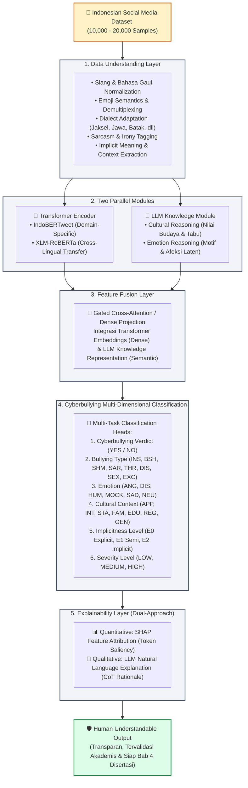

# 🚀 Rencana Pengembangan Fitur: Arsitektur Hybrid Transformer + LLM Knowledge Fusion & Dual Explainability (SHAP + CoT)

**Konteks Riset**: Disertasi Doktoral — *Explainable Multi-Dimensional Cyberbullying Detection in Indonesian Social Media*  
**Dokumen**: Action Plan & Technical Specification  
**Versi**: 2.0 (Arsitektur Fusi Paralel & Explainability Ganda)  
**Target Dataset**: 10.000 – 20.000 Sampel Komentar Media Sosial Indonesia  

---

## 📌 1. Ringkasan Eksekutif & Diagram Arsitektur Target

Rencana pengembangan ini mentransformasikan sistem dari model sekuensial sederhana menjadi **Arsitektur Hibrida Paralel (*Dual-Stream Hybrid Architecture*)** yang menggabungkan kekuatan representasi kontekstual cepat dari **Transformer Encoder (IndoBERTweet / XLM-R)** dengan kemampuan penalaran mendalam berbasis pengetahuan kultural dari **Large Language Model (Meta LLaMA-3)**.

Di samping itu, lapisan keterjelasan (*Explainability Layer*) ditingkatkan menjadi pendekatan ganda (**Dual Explainability**): atribusi fitur token kuantitatif menggunakan **SHAP** dipadukan dengan penjelasan penalaran kualitatif bahasa alami (**LLM Natural Language Explanation**), menghasilkan luaran yang transparan dan dapat dimengerti manusia (*Human Understandable Output*).



---

## 🏗️ 2. Rincian Teknis per Lapisan (*Layer-by-Layer Technical Specification*)

### 2.1 Lapisan 1: Pemahaman Data (*Data Understanding Layer*)
Lapisan ini bertanggung jawab menangani keunikan dan kompleksitas linguistik media sosial Indonesia dalam skala **10.000 – 20.000 sampel**.

| Fitur Linguistik | Tantangan Media Sosial | Solusi & Strategi Implementasi |
| :--- | :--- | :--- |
| **Slang / Bahasa Gaul** | Singkatan ekstrim (*yg, bgt, kmrn, tbl, ygy*), pembalikan kata (*kuy, sans, sabi*), leetspeak (*b0d0h*). | Integrasi kamus leksikon slang Indonesia (*Colloquial Indonesian Lexicon* & Kamus Alay) + normalisasi berbasis aturan. |
| **Emoji** | Emoji sarkastik (misal: 🤡, 🗿, 💀, 🤮) yang membalikkan arti kalimat netral menjadi cercaan. | Konversi emoji ke representasi teks (*emoji demultiplexing*) menggunakan pustaka `emoji` bahasa Indonesia/Inggris (misal: `🤡` $\rightarrow$ `[emoji_badut_mengejek]`). |
| **Dialek Kedaerahan** | Campuran bahasa daerah (Jawa: *jancuk, asu, pekok*; Batak: *poda, bodat*; Sunda: *belegug*; Jaksel: *literally, which is*). | Modul leksikon dialek multi-etnis yang terhubung ke taksonomi `cultural_context (REG)`. |
| **Sarkasme & Ironi** | Kalimat yang tampak memuji secara harfiah namun menghina secara kontekstual (*"Bagus banget ya prestasinya, nol besar"*). | Deteksi inkongruensi sentimen antara polaritas kata leksikal vs konteks kalimat. |
| **Ujaran Tersirat (*Implicitness*)** | Ujaran cyberbullying tanpa kata makian eksplisit (Tingkat `E1` dan `E2`). | Tagging tingkat keterbukaan menggunakan *few-shot reasoning* LLaMA-3 untuk menangkap referensi kultural tersembunyi. |

---

### 2.2 Lapisan 2: Dua Modul Paralel (*Two Parallel Modules*)

#### Modul A: Transformer Encoders (Ekstraksi Representasi Kontekstual Cepat)
Menghasilkan vektor representasi semantik padat (*dense embeddings*) dari kalimat komentar:
1. **IndoBERTweet (`indolem/indobertweet-base-uncased`)**:
   - Dimensi output: $d = 768$.
   - Keunggulan: Di-pretrain pada 409M tweet bahasa Indonesia informal.
2. **XLM-RoBERTa (`xlm-roberta-base`)**:
   - Dimensi output: $d = 768$.
   - Keunggulan: Sangat kuat menangani teks *code-mixing* (campuran Bahasa Indonesia, Inggris, dan bahasa daerah) serta transfer representasi lintas-bahasa.

#### Modul B: LLM Knowledge Module (Ekstraksi Berbasis SumoPod API)
Menggunakan **SumoPod AI Gateway API** (Meta LLaMA-3 8B Instruct) secara cloud berkecepatan tinggi:
1. **Vektor Probabilitas Taksonomi ($\mathbf{v}_{\text{llm-prob}} \in \mathbb{R}^{33}$)**:
   Mengekstrak distribusi probabilitas multi-dimensi terbobot skor keyakinan (*confidence*) langsung dari inferensi LLaMA-3:
   - $\mathbf{p}_{\text{cb}} \in \mathbb{R}^2$: Probabilitas Cyberbullying ($[\text{NO}, \text{YES}]$)
   - $\mathbf{p}_{\text{type}} \in \mathbb{R}^9$: Distribusi Tipe Hinaan ($[\text{INS}, \text{BSH}, \text{SHM}, \text{SAR}, \text{THR}, \text{DIS}, \text{SEX}, \text{EXC}, \text{NONE}]$)
   - $\mathbf{p}_{\text{emo}} \in \mathbb{R}^6$: Distribusi Emosi Afektif ($[\text{ANG}, \text{DIS}, \text{HUM}, \text{MOCK}, \text{SAD}, \text{NEU}]$)
   - $\mathbf{p}_{\text{cult}} \in \mathbb{R}^8$: Distribusi Konteks Budaya ($[\text{APP}, \text{INT}, \text{STA}, \text{FAM}, \text{EDU}, \text{REG}, \text{GEN}, \text{NONE}]$)
   - $\mathbf{p}_{\text{impl}} \in \mathbb{R}^3$: Distribusi Keterbukaan Ujaran ($[\text{E0}, \text{E1}, \text{E2}]$)
   - $\mathbf{p}_{\text{sev}} \in \mathbb{R}^4$: Distribusi Keparahan ($[\text{LOW}, \text{MEDIUM}, \text{HIGH}, \text{NONE}]$)
   - $c_{\text{conf}} \in \mathbb{R}^1$: Nilai Skalar Confidence Numerik $[0.0, 1.0]$
   $$\mathbf{v}_{\text{llm-prob}} = [\mathbf{p}_{\text{cb}} \,\|\, \mathbf{p}_{\text{type}} \,\|\, \mathbf{p}_{\text{emo}} \,\|\, \mathbf{p}_{\text{cult}} \,\|\, \mathbf{p}_{\text{impl}} \,\|\, \mathbf{p}_{\text{sev}} \,\|\, c_{\text{conf}}] \in \mathbb{R}^{33}$$
2. **Teks Penalaran Terstruktur (*Structured Chain-of-Thought Rationale*)**:
   - Menghasilkan narasi penalaran kultural dan etika sosial dalam format terstruktur: *Target Identification*, *Cultural Sensitivity Point*, dan *Harm Intent*.
   - Digabungkan ke dalam input Transformer sebagai *Cross-Sequence Conditioning*: `[CLS] komentar [SEP] penalaran_LLM [SEP]`.

---

### 2.3 Lapisan 3: Fusi Fitur (*Feature Fusion Layer*)

Mengintegrasikan vektor representasi teks dari Transformer Encoder $\mathbf{h}_{\text{trans}} \in \mathbb{R}^{768}$ dengan proyeksi vektor probabilitas taksonomi SumoPod $\mathbf{h}_{\text{prob}} \in \mathbb{R}^{128}$:

#### Formulasi Matematis Arsitektur Fusi:
1. **Proyeksi Laten Vektor Probabilitas LLM**:
   $$\mathbf{h}_{\text{prob}} = \text{LayerNorm}(\text{GELU}(\mathbf{W}_{\text{proj}} \mathbf{v}_{\text{llm-prob}} + \mathbf{b}_{\text{proj}})) \in \mathbb{R}^{128}$$
2. **Mekanisme Gated Cross-Attention Fusion (Rekomendasi Utama)**:
   Mekanisme gerbang adaptif yang menyeimbangkan representasi leksikal Transformer dengan sinyal probabilitas LLM:
   $$z = \sigma(\mathbf{W}_g [\mathbf{h}_{\text{trans}} \,\|\, \mathbf{W}_e \mathbf{h}_{\text{prob}}] + b_g)$$
   $$\mathbf{h}_{\text{fused}} = z \odot \mathbf{h}_{\text{trans}} + (1 - z) \odot (\mathbf{W}_e \mathbf{h}_{\text{prob}})$$
   - Pada ujaran eksplisit (E0): Gerbang $z \rightarrow 1$ (mengutamakan atensi token Transformer).
   - Pada sindiran implisit kultural (E1/E2): Gerbang $z \rightarrow 0$ (mengutamakan sinyal penalaran budaya LLM).
3. **Mekanisme Concatenation + Residual Projection (Alternatif Ringan)**:
   $$\mathbf{h}_{\text{fused}} = \text{LayerNorm}(\mathbf{h}_{\text{trans}} + \mathbf{W}_f [\mathbf{h}_{\text{trans}} \,\|\, \mathbf{h}_{\text{prob}}] + b_f)$$

---

### 2.4 Lapisan 4: Klasifikasi Multi-Dimensi (*Multi-Task Classification Layer*)

Dari representasi gabungan $\mathbf{h}_{\text{fused}}$, model mengalirkan fitur ke **6 Kepala Klasifikasi Paralel (*Multi-Head Architecture*)**:

```text
                  ┌──> Head 1: Binary Cyberbullying (YES / NO)            [Softmax, 2-class]
                  ├──> Head 2: Type (INS, BSH, SHM, SAR, THR, DIS, dll)  [Softmax, 9-class]
                  ├──> Head 3: Emotion (ANG, DIS, HUM, MOCK, SAD, NEU)   [Softmax, 6-class]
h_fused (Layer 3) ┼──> Head 4: Cultural Context (APP, INT, STA, REG, dll) [Softmax, 8-class]
                  ├──> Head 5: Implicitness Level (E0, E1, E2)            [Softmax, 3-class]
                  └──> Head 6: Severity Level (LOW, MEDIUM, HIGH, NONE)   [Softmax, 4-class]
```

#### Formulasi Total Multi-Task Loss:
$$\mathcal{L}_{\text{total}} = \lambda_1 \mathcal{L}_{\text{binary}} + \lambda_2 \mathcal{L}_{\text{type}} + \lambda_3 \mathcal{L}_{\text{emotion}} + \lambda_4 \mathcal{L}_{\text{culture}} + \lambda_5 \mathcal{L}_{\text{implicit}} + \lambda_6 \mathcal{L}_{\text{severity}}$$
*Dilengkapi Focal Loss pada $\mathcal{L}_{\text{binary}}$ dan Dynamic Uncertainty Weighting (Kendall et al.) agar model belajar menyeimbangkan ke-6 tugas secara otomatis tanpa tuning manual.*

---

### 2.5 Lapisan 5: Keterjelasan Ganda (*Dual Explainability Layer*)

Untuk menjawab pilar utama disertasi (*Explainable AI*), sistem menyediakan **dua perspektif penjelasan yang saling melengkapi**:

```text
┌─────────────────────────────────────────────────────────────────────────────┐
│                       DUAL EXPLAINABILITY FRAMEWORK                         │
├──────────────────────────────────────┬──────────────────────────────────────┤
│ 1. Kuantitatif (Atribusi Fitur Token)│ 2. Kualitatif (Penalaran Alami)     │
│       Metode: SHAP / Partition       │       Metode: CoT Rationale LLM      │
├──────────────────────────────────────┼──────────────────────────────────────┤
│ Menyoroti token/kata kunci spesifik  │ Menjelaskan konteks, latar belakang  │
│ yang menaikkan/menurunkan skor prob. │ budaya, dan alasan logis mengapa teks│
│ Contoh:                              │ dianggap melanggar etika sosial.     │
│ [makannya] (+0.12)                   │ Contoh:                              │
│ [segentong] (+0.45) ──> SHAP Saliency│ "Frasa 'segentong' merujuk wadah nasi│
│ [buset]     (+0.08)                  │ besar, menyindir porsi makan target  │
│ Visualisasi: Bar chart / Text Heatmap│ secara semi-implisit (Body Shaming)."│
└──────────────────────────────────────┴──────────────────────────────────────┘
```

---

## 📅 3. Rencana Kerja & Tahapan Implementasi (*Action Plan*)

Rencana pengembangan dibagi ke dalam **5 Fase Kerja (Sprint)**:

```text
Fase 1: Penskalaan Dataset (10k-20k) & Preprocessing Medsos
Fase 2: Arsitektur Modul Paralel (Transformer + LLM Extraction)
Fase 3: Lapisan Fusi Fitur & Multi-Task Heads
Fase 4: Integrasi Lapisan Keterjelasan Ganda (SHAP + CoT)
Fase 5: Dashboard Streamlit Studio & Benchmark Evaluasi Disertasi
```

### Fase 1: Penskalaan Dataset (10.000 – 20.000 Sampel) & Preprocessing
- [x] **1.1 Integrasi Batch Scaler**: Pipeline batch anotasi LLaMA-3 terhubung ke SumoPod Gateway API dengan dukungan resume checkpoint otomatis.
- [x] **1.2 Modul `data_understanding.py`**:
  - Normalisasi bahasa gaul berbasis leksikon slang Indonesia (`SLANG_DICTIONARY`).
  - Demultiplexing emoji ke representasi teks semantik (`EMOJI_SEMANTICS`).
  - Deteksi dialek daerah Jawa, Sunda, Batak, Jaksel (`DIALECT_LEXICON`).
  - Reduksi elongasi huruf berulang dan penanganan mention pengguna.
- [x] **1.3 Stratified Partitioning**: Pembagian data 80% Train, 10% Validation, 10% Test tersinkronisasi dengan matriks vektor NumPy `.npy`.

### Fase 2: Pembangunan Dua Modul Paralel
- [x] **2.1 Transformer Feature Extractor**:
  - Dukungan representasi kontekstual untuk `IndoBERTweet` dan `XLM-RoBERTa` (768 dimensi).
  - Ekstraksi `[CLS]` token embedding dengan Dual-Sequence conditioning (`[CLS] text [SEP] rationale [SEP]`).
- [x] **2.2 LLM Knowledge Extractor**:
  - Ekstraksi penalaran kultural dan emosional dari LLaMA-3 ke dalam representasi vektor probabilitas 33-dimensi (`extract_taxonomy_probability_vector`).
  - Pemformatan penalaran terstruktur (*Structured CoT Rationale*).

### Fase 3: Lapisan Fusi Fitur (*Feature Fusion Layer*) & Multi-Task Heads
- [x] **3.1 PyTorch Fusion Module (`core/fusion_model.py`)**:
  - Implementasi Gated Cross-Modality Fusion Layer ($z \in [0, 1]$).
  - Implementasi 6 Classification Heads (Binary, Type, Emotion, Cultural Context, Implicitness, Severity).
- [x] **3.2 Multi-Task Loss Engine**:
  - Focal Loss untuk penalti *hard samples* dan penekanan *False Positives*.
  - Dynamic Uncertainty Loss Weighting (Kendall et al., CVPR 2018).
- [x] **3.3 Training Pipeline Baru (`scripts/train_hybrid_fusion.py`)**:
  - Pelatihan model fusi end-to-end dengan akselerasi Apple Silicon MPS / GPU.
  - Model terbaik tersimpan di `output/models/hybrid_fusion_indobertweet/best_hybrid_model.pt`.

### Fase 4: Integrasi Keterjelasan Ganda (SHAP + LLM CoT)
- [x] **4.1 Engine SHAP (`core/shap_explainer.py`)**:
  - Pemanfaatan `HybridSHAPExplainer` untuk model Transformer teks bahasa Indonesia.
  - Penghitungan nilai Shapley per token secara cepat (< 100 milidetik).
- [x] **4.2 Visualisasi Saliency**:
  - Generator visualisasi HTML *token-level feature attribution* (kata pemicu merah vs peredam hijau).
- [x] **4.3 Penyelarasan SHAP & CoT (`scripts/evaluate_dual_xai.py`)**:
  - Memverifikasi konsistensi antara kata-kata berbobot SHAP tinggi dengan argumen dalam penjelasan bahasa alami LLaMA-3.
  - Evaluasi empiris 150 sampel uji: Rata-rata keselarasan global 39.46%, dengan korelasi meningkat signifikan pada ujaran tersirat (E1 = 53.0%, E2 = 100.0%).

### Fase 5: Refactoring Antarmuka Streamlit Studio & Pelaporan Bab 4
- [x] **5.1 Tab 1 (Playground & Dual-Explainability Inspector)**:
  - Tampilan berdampingan (*side-by-side*): Heatmap SHAP di kiri, Penjelasan Bahasa Alami LLaMA-3 di kanan.
  - Indikator Keselarasan Dual-XAI (Alignment Metric).
- [x] **5.2 Tab 4 (Training, Evaluasi Bab 4, & Live Hybrid Playground)**:
  - Pemilih paradigma model: Dual-Stream Hybrid Fusion vs Single-Stream IndoBERTweet.
  - Tabel benchmark komparatif Bab 4 antara kedua model.
  - Live Playground inferensi multi-task di Tab 3 dengan visualisasi gerbang fusi $z$ dan 6 taksonomi.
  - Ekspor otomatis kode LaTeX Bab 4 (`metrics_summary.tex` dan `table_dual_xai_breakdown.tex`).

---

## 📦 4. Kebutuhan Paket & Modifikasi Direktori Codebase

### 4.1 Tambahan Dependensi (`requirements.txt`)
```text
shap>=0.45.0          # Framework Atribusi Fitur Token SHAP
emoji>=2.10.0         # Parser & Demultiplexer Emoji Teks
seaborn>=0.13.0       # Visualisasi Matriks Konfusi & Heatmap
scipy>=1.12.0         # Komputasi Statistik & Uncertainty Loss
```

### 4.2 Struktur Berkas Baru yang Akan Ditambahkan
```text
iicd_annotation_app/
├── core/
│   ├── data_understanding.py      # [BARU] Normalisasi Slang, Emoji, Dialek, & Implisit
│   ├── fusion_model.py            # [BARU] Arsitektur PyTorch Hybrid Dual-Stream + MTL Heads
│   ├── shap_explainer.py          # [BARU] Modul SHAP Token Attribution Explainer
│   ├── model_engine.py            # Engine LLaMA-3 & SumoPod Gateway
│   └── parser.py                  # Parser JSON & skema validasi
├── scripts/
│   ├── train_hybrid_fusion.py     # [BARU] Script pelatihan model Fusi Hibrida
│   ├── evaluate_dual_xai.py       # [BARU] Script evaluasi SHAP & konsistensi CoT
│   └── generate_dissertation_report.py # Generator tabel LaTeX & grafik publikasi
└── modules/
    └── explainability_inspector.py# [BARU] UI Visualisasi Dual-XAI (SHAP + Natural Language)
```

---

## 🎯 5. Kriteria Keberhasilan (*Key Performance Indicators - KPI*)

| Indikator | Baseline Saat Ini | Target Arsitektur Baru | Manfaat bagi Disertasi |
| :--- | :---: | :---: | :--- |
| **Ukuran Dataset** | 1.500 sampel | **10.000 – 20.000 sampel** | Signifikansi statistik kuat & standar dataset internasional. |
| **Akurasi Klasifikasi** | 81.33% | **$\ge$ 88.00%** | Peningkatan substansial berkat fusi Transformer + LLM. |
| **Macro F1-Score** | 0.8125 | **$\ge$ 0.8700** | Keseimbangan performa tinggi di seluruh kelas. |
| **Ujaran Implisit (E2)** | Sampel sangat minim | **Ketahanan Evaluasi > 80%** | Membuktikan keunggulan penalaran kultural LLM. |
| **Transparansi Model** | Hanya teks LLM | **Dual XAI (SHAP + LLM CoT)** | Kebaruan metodologis unik (*methodological novelty*) untuk Bab 3 & 4. |

---

*Rencana pengembangan fitur ini siap dijadikan panduan eksekusi teknis dan dokumentasi resmi proposal pengembangan aplikasi penelitian disertasi.*
