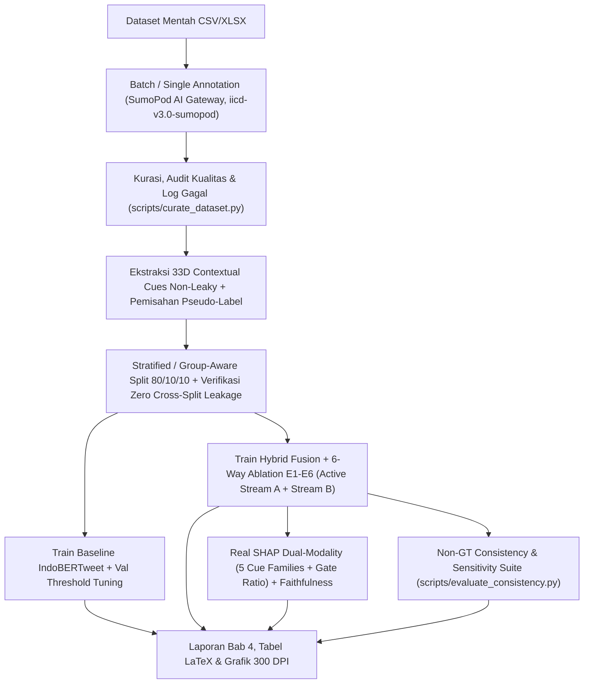

# 🛡️ IICD — LLM-Augmented Explainable Annotation & Distillation Studio

Sistem Penelitian Disertasi Doktoral untuk **Deteksi Cyberbullying Bahasa Indonesia Berbasis Dual-Stream Hybrid Fusion (IndoBERTweet + SumoPod LLM AI Gateway)**, Distilasi Pengetahuan Taksonomi 6-Dimensi, dan Kerangka Kerja **Dual-Modality Explainable AI (Real SHAP + Chain-of-Thought Rationale)**.

> [!NOTE]
> **Kebijakan Metodologi Riset (`pseudo_labeled_llm`, v3.0)**: Penelitian ini menggunakan **LLM-generated pseudo-labels** sebagai target supervisi utama (tanpa kewajiban human ground truth). Untuk menjaga integritas Dual-Stream Hybrid Fusion tanpa kebocoran target (*zero target copy*), **Stream B** direkonstruksi menjadi **33D Non-Leaky Contextual Evidence Cues** (Linguistic, Cultural, Emotional, Pragmatic, Contextual) sehingga **Stream A + Stream B aktif secara konsisten pada training, validation, testing, dan live inference**.

---

## 1. Arsitektur Sistem & Alur Kerja Penelitian

### A. Arsitektur Dual-Stream Hybrid Fusion (6-Head MTL)


### B. Alur Kerja End-to-End Pipeline Penelitian



---

## 2. Metodologi Dataset, Pseudo-Label & Representasi 33D Non-Leaky

Pipeline kurasi berada pada `core/data_understanding.py`, `core/schema.py`, `data_manager/dataset_handler.py`, dan `scripts/curate_dataset.py`.

1. **Audit Kualitas Tanpa Mengubah Data Mentah**:
   - Memeriksa *missing values*, komentar kosong/`< 3` karakter, duplikasi mentah maupun duplikasi pasca-normalisasi, validitas kode taksonomi, validitas `confidence score`, konsistensi logis (`cyberbullying == "NO"` tidak boleh memiliki sub-tipe/keparahan perundungan), serta mengeliminasi baris simulasi `MockEngine` (`is_mock=True` atau `annotation_source="mock_simulation"`).
   - Kegagalan ekstraksi JSON di `core/parser.py`, field hilang di `core/schema.py`, maupun seluruh sampel yang gagal anotasi disimpan secara transparan ke `output/final/failed_annotations_log.json` beserta alasannya; kode hilang dipertahankan sebagai `MISSING_LABEL = "UNKNOWN"` dan `confidence = None`.
2. **Kebijakan Supervisi Pseudo-Label LLM & Metadata**:
   - Seluruh dataset tanpa kolom `human_ground_truth` secara eksplisit dilabeli **`pseudo_labeled_llm`** pada `dataset_manifest.json`, mencatat `llm_models_used`, `prompt_versions_used`, dan `confidence_policy = "raw_llm_confidence_uncalibrated"`.
   - Fitur prediktor Stream B (`extract_contextual_evidence_vector()`) diekstrak **tanpa menyalin satu pun kolom target klasifikasi** (`cyberbullying`, `type`, `emotion`, `cultural_context`, `implicit_level`, `severity`).
3. **Taksonomi Representasi 33D Contextual Evidence Cues**:
   - `[0:7]` (**Linguistic**, 7D): `ling_derogatory_lexical`, `ling_metaphor_simile`, `ling_rhetorical_punct`, `ling_elongation_emphasis`, `ling_slang_register`, `ling_second_person_target`, `ling_negation_litotes`.
   - `[7:14]` (**Cultural**, 7D): `cult_regional_dialect_cue`, `cult_appearance_norm_cue`, `cult_competence_norm_cue`, `cult_status_hierarchy_cue`, `cult_family_kinship_cue`, `cult_education_norm_cue`, `cult_gender_identity_cue`.
   - `[14:21]` (**Emotional**, 7D): `emo_hostility_aggression`, `emo_derision_ridicule`, `emo_disgust_contempt`, `emo_humiliation_shaming`, `emo_sadness_distress`, `emo_calm_neutral_register`, `emo_sarcastic_emoji_affect`.
   - `[21:27]` (**Pragmatic**, 6D): `prag_irony_sarcasm_signal`, `prag_presupposition_insinuation`, `prag_indirect_advice_framing`, `prag_hyperbole_exaggeration`, `prag_imperative_attack`, `prag_benign_supportive`.
   - `[27:33]` (**Contextual**, 6D): `ctx_direct_addressee_target`, `ctx_public_platform_stage`, `ctx_evaluative_judgment`, `ctx_harm_impact_evidence`, `ctx_provocation_reply`, `ctx_teacher_confidence_raw` (nilai skalar mentah `[0, 1]`, tidak diklaim sebagai probabilitas terkalibrasi).

---

## 3. Preprocessing Bahasa Sosial Media Indonesia

Fungsi `clean_and_normalize_social_text()` diterapkan identik pada tahap kurasi, training, evaluasi, SHAP, dan inferensi live:
- Pembersihan URL, mention (`@user`), normalisasi spasi ganda (`clean_text`).
- Normalisasi slang & singkatan medsos Indonesia (`slang_dict` seperti *bgt → banget*, *gw → aku*, *kaga → tidak*).
- Demultipleks emoji (`emoji.demojize`) ke token deskriptif.
- Deteksi sinyal dialek daerah (`Sunda`, `Jawa`, `Betawi`, dsb.).
- Deduplikasi lintas-teks dan pemeriksaan otomatis `verify_no_cross_split_leakage()` guna menjamin **0 irisan komentar mentah maupun ternormalisasi** di antara `train.csv`, `val.csv`, dan `test.csv`.

---

## 4. Arsitektur Hybrid Fusion & Training Pipeline

Implementasi berada pada `core/fusion_model.py`, `scripts/train_indobertweet.py`, dan `scripts/train_hybrid_fusion.py`:

- **Gated Cross-Modality Fusion**:
  $$h_{\text{llm\_aligned}} = \text{LayerNorm}(\text{GELU}(W_a h_{\text{prob}} + b_a))$$
  $$z = \sigma(W_g [h_{\text{trans}} \| h_{\text{llm\_aligned}}] + b_g)$$
  $$h_{\text{fused}} = \text{Dropout}(\text{LayerNorm}(z \odot h_{\text{trans}} + (1 - z) \odot h_{\text{llm\_aligned}}))$$
- **Multi-Task Loss + Masking `-100` + Uncertainty Weighting**:
  - `Head Binary`: `FocalLoss(alpha=0.60, gamma=2.0, ignore_index=-100)`
  - `Head Type, Emotion, Cultural, Implicit, Severity`: `masked_cross_entropy(..., ignore_index=-100)`
  - Bobot multi-task adaptif dipelajari melalui `MultiTaskUncertaintyLoss` (Kendall et al.) yang ikut teroptimasi dalam backpropagation, dengan guard terhadap batch yang seluruh label sub-tugasnya bernilai `-100`.
- **Protokol Pelatihan Reproduksibel**:
  - Random seed tetap (`DEFAULT_RANDOM_SEED = 42`), AdamW dengan differential learning rate (`2e-5` backbone Transformer, `1e-4` fusion & 6 heads), linear warmup scheduler (10%), gradient clipping (`1.0`), early stopping, serta checkpoint resume (`latest_checkpoint.pt` / `--resume`).
  - Optimasi threshold keputusan ($\tau^*$) dilakukan **secara eksklusif pada Validation Set** (`find_optimal_threshold_on_val`), kemudian dikunci dan disimpan di `model_manifest.json` untuk evaluasi Test Set dan inferensi.

---

## 5. Evaluasi, Studi Ablasi & Dual Explainability (Real `shap`)

1. **Metrik Evaluasi Komprehensif (`core/evaluation_metrics.py`)**:
   - Accuracy, Macro Precision/Recall, **Macro F1-Score (metrik utama)**, Weighted F1-Score, ROC-AUC, PR-AUC, Confusion Matrix, Calibration Metrics (**ECE, MCE, Brier Score, Log-Loss**), Bootstrap 95% Confidence Interval, rincian tingkat keterbukaan (`E0`, `E1`, `E2`), rincian tipe cyberbullying, serta Error Analysis False Positive / False Negative.
   - `scripts/generate_dissertation_report.py` menolak membuat probabilitas/metrik simulasi apabila checkpoint belum tersedia (`FileNotFoundError`).
2. **Studi Ablasi 6-Konfigurasi pada Split Identik (`ablation_comparison.json`)**:
   - **E1**: Transformer-Only Baseline (Stream A aktif, Stream B di-mask nol)
   - **E2**: LLM Knowledge-Only Model (`LLMKnowledgeOnlyClassifier`, 33D Contextual Cues tanpa penyalinan target)
   - **E3**: Full Hybrid Transformer-LLM Fusion (Gated Cross-Modality Fusion, Stream A + 33D Contextual Cues aktif pada Train/Val/Test)
   - **E4**: Hybrid without Cultural Knowledge (dimensi Cultural `[7:14]` dimask nol)
   - **E5**: Hybrid without Emotional Knowledge (dimensi Emotional `[14:21]` dimask nol)
   - **E6**: Hybrid without Gated Fusion (Concat Fusion Projection)
3. **Hasil Empiris Aktual pada Checkpoint Terkurasi Saat Ini (`iicd-curated-8ee578088376`, 49 baris teranotasi LLM valid dari 1.508 baris mentah: 39 Train / 5 Val / 5 Test, `target_source = pseudo_labeled_llm`, 0 Cross-Split Overlap)**:
   - **E1 (Transformer-Only)**: Accuracy = **80.00%**, Macro-F1 = **0.4444**, ROC-AUC = **0.0000**, PR-AUC = **0.6792**, Mean Gate $z = 0.4970$
   - **E2 (LLM Knowledge-Only 33D)**: Accuracy = **80.00%**, Macro-F1 = **0.7619**, ROC-AUC = **1.0000**, PR-AUC = **1.0000**
   - **E3 (Full Hybrid Gated Fusion, $\tau^*=0.20$ pada Val)**: Accuracy = **80.00%**, Macro-F1 = **0.4444**, PR-AUC = **0.6792**, Mean Gate $z = 0.4941$ (Multi-Task Head Acc pada Test: Type **20.00%**, Emotion **40.00%**, Cultural **20.00%**, Implicit **40.00%**, Severity **20.00%**)
   - **E4 (Hybrid no Cultural)** & **E5 (Hybrid no Emotional)**: Accuracy = **80.00%**, Macro-F1 = **0.4444**, Mean Gate $z = 0.4943 / 0.4937$
   - **E6 (Hybrid Concat, non-gated)**: Accuracy = **80.00%**, Macro-F1 = **0.4444**, ROC-AUC = **1.0000**, PR-AUC = **1.0000**
4. **Dual Explainability & Cross-Modal Gate (`core/shap_explainer.py`, `scripts/evaluate_dual_xai.py`)**:
   - Menggunakan `shap.Explainer(..., shap.maskers.Text)` untuk **Stream A (atribusi token)** dan `shap.Explainer` tabular untuk **Stream B (33D Contextual Cues + agregasi 5 Cue Families: Cultural 0.0063, Emotional 0.0051, Contextual 0.0051, Pragmatic 0.0042, Linguistic 0.0034)**.
   - Mengukur **Faithfulness Comprehensiveness ($\Delta p$)** (5 sampel uji: Mean $\Delta p = 0.0144$) serta memisahkan **Diagnostik Lexical Overlap CoT** (50.0% / 60.0%) dari klaim validitas kausal.
5. **Non-GT Consistency & Sensitivity Suite (`scripts/evaluate_consistency.py`)**:
   - Mengaudit distribusi kelas & *imbalance ratio*, aktivasi 5 keluarga cue Stream B (`nonzero_rate` 40%–100%), kesepakatan guru-murid (Cohen's $\kappa$ antara pseudo-label LLM vs prediksi 6-Head Hybrid Model), analisis FP/FN per `implicit_level`, serta *repeat-run Krippendorff $\alpha$* bila dijalankan dengan API SumoPod aktif.

---

## 6. Instalasi, Konfigurasi & Menjalankan Aplikasi

### Instalasi Dependensi

```bash
pip install -r requirements.txt
```

### Konfigurasi SumoPod AI Gateway

Simpan API Key SumoPod secara lokal (tidak dilacak Git oleh `.gitignore`):
- Melalui `.streamlit/secrets.toml`:
  ```toml
  SUMOPOD_API_KEY = "sk-your-sumopod-key"
  ```
- Atau variabel lingkungan:
  ```bash
  export SUMOPOD_API_KEY="sk-your-sumopod-key"
  ```
Backend LLM menggunakan **SumoPod AI Gateway** (`https://api.sumopod.com/v1`) dengan model default `deepseek-ai/DeepSeek-V3`, `openai/gpt-4o-mini`, atau `google/gemini-2.5-flash`. Mode simulasi (`MockEngine`) hanya digunakan sebagai *fallback* UI offline dan otomatis ditolak dalam proses kurasi dataset riset.

### Menjalankan Aplikasi Streamlit

```bash
./run.sh
# atau
streamlit run app.py
```

### Menjalankan Pipeline CLI (Kurasi, Training, Evaluasi, Dual-XAI & Tes)

```bash
# 1. Kurasi dataset, pemisahan target vs LLM features & verifikasi anti-leakage
python3 scripts/curate_dataset.py

# 2. Training Baseline IndoBERTweet (optimasi threshold di Validation Set)
python3 scripts/train_indobertweet.py --epochs 4

# 3. Training Dual-Stream Hybrid Fusion 6-Head MTL & Studi Ablasi 6-Arah (E1-E6)
python3 scripts/train_hybrid_fusion.py --epochs 4

# 4. Evaluasi Real SHAP Dual-XAI (5 Cue Families + Gate Ratio) & Faithfulness Comprehensiveness
python3 scripts/evaluate_dual_xai.py --model-type hybrid --max-samples 30

# 5. Evaluasi Non-GT Consistency, Cohen Kappa Guru-Murid & Repeat-Run Stability
python3 scripts/evaluate_consistency.py

# 6. Generate Laporan Evaluasi Komprehensif, Grafik 300 DPI & Tabel LaTeX
python3 scripts/generate_dissertation_report.py

# 7. Menjalankan seluruh Unit & Integration Test + Streamlit AppTest
pytest tests/test_iicd_pipeline.py -v
```

---

## 7. Struktur Direktori & Penyimpanan Model

```text
iicd_annotation_app/
├── app.py                              # Entry point Streamlit Studio (5 Tab Utama)
├── config.py                           # Konfigurasi global, taksonomi IICD & path artefak
├── core/
│   ├── schema.py                       # Validasi skema & preservasi MISSING_LABEL ("UNKNOWN")
│   ├── parser.py                       # Ekstraktor JSON SumoPod tahan error
│   ├── prompt_templates.py             # Prompt terversi (PROMPT_VERSION)
│   ├── model_engine.py                 # SumopodEngine (retry + backoff + logprobs) & MockEngine
│   ├── data_understanding.py           # Normalisasi teks & ekstraksi 33D Teacher Features
│   ├── fusion_model.py                 # HybridFusionModel, Gated Fusion, FocalLoss (-100), MTL
│   ├── evaluation_metrics.py           # PR-AUC, ECE/MCE/Brier, Bootstrap CI & model_manifest
│   └── shap_explainer.py               # Real shap.Explainer Dual-Modality + Comprehensiveness
├── data_manager/
│   ├── dataset_handler.py              # Validasi file upload, deteksi kolom GT & HTML escaping
│   └── checkpoint_manager.py           # Checkpoint anotasi CSV/Excel & resume progress
├── modules/                            # Halaman UI Streamlit (Single, Batch, Analytics, Training, Settings)
├── scripts/                            # Skrip CLI reproduksibel (curate, train, evaluate, report)
├── tests/
│   └── test_iicd_pipeline.py           # Suite pengujian terintegrasi (9 kelompok tes end-to-end)
└── output/
    ├── checkpoints/                    # Checkpoint anotasi mentah (tidak dimodifikasi kurasi)
    ├── final/                          # train/val/test CSV, 33D *.npy, dataset_manifest.json
    ├── models/                         # Checkpoint best_model / best_hybrid_model.pt + model_manifest.json
    └── evaluation_report/              # metrics_summary.json, dual_xai_evaluation.json, *.tex, *.png
```

---

## 8. Batasan Metodologis & Catatan Eksekusi Saat Ini

1. **Supervisi Pseudo-Label LLM (`pseudo_labeled_llm`)**: Seluruh pelatihan dan evaluasi pada penelitian ini menggunakan pseudo-label yang dihasilkan LLM SumoPod tanpa ketergantungan pada human ground truth. Metrik diukur sebagai kesepakatan serta konsistensi antara model hybrid dengan pseudo-label dan bukti kontekstual LLM.
2. **Cakupan Anotasi Checkpoint Saat Ini**: Berkas `checkpoint_Dataset-Research.csv` saat ini berisi **1.508 baris mentah**, namun **49 baris** di antaranya memiliki anotasi LLM valid (39 Train / 5 Val / 5 Test) dan **1.459 baris** lainnya tercatat di `failed_annotations_log.json` karena belum teranotasi (`cyberbullying` kosong). Melengkapi batch annotation pada seluruh 1.508 baris lalu menjalankan ulang pipeline kurasi–pelatihan–evaluasi akan meningkatkan representativitas statistik split validasi dan uji (khususnya sub-kelas `E2` dan taksonomi minor `SAR`, `SHM`, `EXC`, `SEX`).
