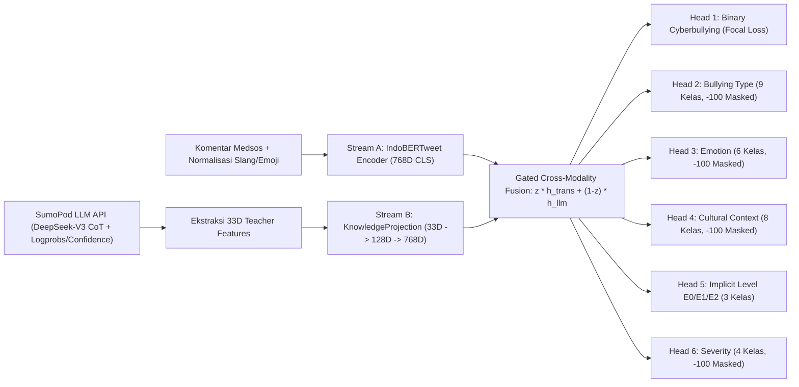
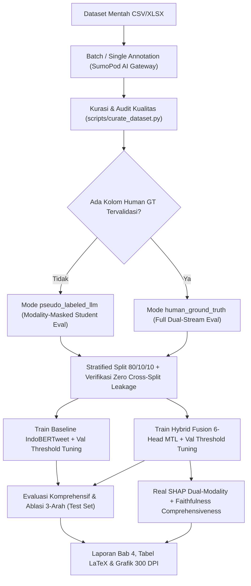

# 🛡️ IICD — LLM-Augmented Explainable Annotation & Distillation Studio

Sistem Penelitian Disertasi Doktoral untuk **Deteksi Cyberbullying Bahasa Indonesia Berbasis Dual-Stream Hybrid Fusion (IndoBERTweet + SumoPod LLM AI Gateway)**, Distilasi Pengetahuan Taksonomi 6-Dimensi, dan Kerangka Kerja **Dual-Modality Explainable AI (Real SHAP + Chain-of-Thought Rationale)**.

> [!NOTE]
> **Prinsip Integritas Metodologis (v2.0.0)**: Seluruh pipeline memisahkan secara ketat antara **Ground Truth Manusia Tervalidasi (`human_ground_truth`)**, **Pseudo-Label Anotasi LLM (`pseudo_labeled_llm`)**, dan **Teacher Annotation Features 33-Dimensi**. Evaluasi pada dataset `pseudo_labeled_llm` secara otomatis mengaktifkan **Modality-Masked Student Mode** (*Modality Dropout* saat training, Stream-B dimask saat validasi/uji) untuk menjamin nihilnya kebocoran target (*zero target leakage*).

---

## 1. Arsitektur Sistem & Alur Kerja Penelitian

### A. Arsitektur Dual-Stream Hybrid Fusion (6-Head MTL)



### B. Alur Kerja End-to-End Pipeline Penelitian



---

## 2. Metodologi Dataset, Kurasi & Pemisahan Label

Pipeline kurasi berada pada `core/data_understanding.py`, `core/schema.py`, `data_manager/dataset_handler.py`, dan `scripts/curate_dataset.py`.

1. **Audit Kualitas Tanpa Mengubah Data Mentah**:
   - Memeriksa *missing values*, komentar kosong/`< 3` karakter, duplikasi mentah maupun duplikasi pasca-normalisasi, validitas kode taksonomi, validitas `confidence score`, konsistensi logis (`cyberbullying == "NO"` tidak boleh memiliki sub-tipe/keparahan perundungan), serta mengeliminasi baris simulasi `MockEngine` (`is_mock=True` atau `annotation_source="mock_simulation"`).
   - Kegagalan ekstraksi JSON di `core/parser.py` maupun field hilang di `core/schema.py` dipertahankan secara eksplisit sebagai `MISSING_LABEL = "UNKNOWN"` dan `confidence = None` (tidak pernah dipaksa menjadi `"NO"` atau `0.0`).
2. **Pemisahan Ketat Ground Truth vs Anotasi LLM vs Fitur 33D**:
   - Kolom target riset (`target_*`) hanya mengambil label tervalidasi (`human_ground_truth`, `gold_label`, dst.) apabila tersedia; jika belum tersedia, dataset diberi penanda eksplisit **`pseudo_labeled_llm`** pada `dataset_manifest.json`.
   - Kolom sentimen umum (`sentiment`) tidak diasumsikan sebagai ground truth cyberbullying.
   - Fitur prediktor Stream B diekstrak secara eksklusif dari kolom `llm_*` (`extract_teacher_annotation_features()`), bukan dari kolom `target_*`.
3. **Dokumentasi Representasi Teacher Vector 33-Dimensi**:
   - `[0:2]`: `teacher_cyberbullying` (`NO`, `YES`)
   - `[2:11]`: `teacher_type` (9 kelas taksonomi)
   - `[11:17]`: `teacher_emotion` (6 kelas emosi)
   - `[17:25]`: `teacher_cultural_context` (8 kelas konteks budaya Indonesia)
   - `[25:28]`: `teacher_implicit_level` (`E0`, `E1`, `E2`)
   - `[28:32]`: `teacher_severity` (`LOW`, `MEDIUM`, `HIGH`, `NONE`)
   - `[32]`: `teacher_confidence` skalar `[0.0, 1.0]`
   - Apabila API mengembalikan probabilitas/logprobs terkalibrasi per kelas (`class_probabilities`), nilai aktual digunakan; jika hanya kategori diskret + confidence skalar tersedia, digunakan indikator diskret biner + skalar confidence pada indeks `[32]` (vektor nol untuk `UNKNOWN`) tanpa mengklaim distribusi buatan sebagai probabilitas terkalibrasi.

---

## 3. Preprocessing Bahasa Sosial Media Indonesia

Fungsi `clean_and_normalize_social_text()` diterapkan identik pada tahap kurasi, training, evaluasi, SHAP, dan inferensi live:
- Pembersihan URL, mention (`@user`), normalisasi spasi ganda (`clean_text`).
- Normalisasi slang & singkatan medsos Indonesia (`slang_dict` seperti *bgt → banget*, *gw → aku*, *kaga → tidak*).
- Demultipleks emoji (`emoji.demojize`) ke token deskriptif.
- Deteksi sinyal dialek daerah (`Sunda`, `Jawa`, `Betawi`, dsb.).
- Deduplikasi lintas-teks dan pemeriksaan otomatis `verify_no_cross_split_leakage()` guna menjamin **0 irisan komentar mentah maupun ternormalisasi** di antara `train.csv`, `val.csv`, dan `test.csv`.

---

## 4. Arsitektur Hybrid Fusion & Training Pipeline

Implementasi berada pada `core/fusion_model.py`, `scripts/train_indobertweet.py`, dan `scripts/train_hybrid_fusion.py`:

- **Gated Cross-Modality Fusion**:
  $$h_{\text{llm\_aligned}} = \text{LayerNorm}(\text{GELU}(W_a h_{\text{prob}} + b_a))$$
  $$z = \sigma(W_g [h_{\text{trans}} \| h_{\text{llm\_aligned}}] + b_g)$$
  $$h_{\text{fused}} = \text{Dropout}(\text{LayerNorm}(z \odot h_{\text{trans}} + (1 - z) \odot h_{\text{llm\_aligned}}))$$
- **Multi-Task Loss + Masking `-100` + Uncertainty Weighting**:
  - `Head Binary`: `FocalLoss(alpha=0.60, gamma=2.0, ignore_index=-100)`
  - `Head Type, Emotion, Cultural, Implicit, Severity`: `masked_cross_entropy(..., ignore_index=-100)`
  - Bobot multi-task adaptif dipelajari melalui `MultiTaskUncertaintyLoss` (Kendall et al.) yang ikut teroptimasi dalam backpropagation, dengan guard terhadap batch yang seluruh label sub-tugasnya bernilai `-100`.
- **Protokol Pelatihan Reproduksibel**:
  - Random seed tetap (`DEFAULT_RANDOM_SEED = 42`), AdamW dengan differential learning rate (`2e-5` backbone Transformer, `1e-4` fusion & 6 heads), linear warmup scheduler (10%), gradient clipping (`1.0`), early stopping, serta checkpoint resume (`latest_checkpoint.pt` / `--resume`).
  - Optimasi threshold keputusan ($\tau^*$) dilakukan **secara eksklusif pada Validation Set** (`find_optimal_threshold_on_val`), kemudian dikunci dan disimpan di `model_manifest.json` untuk evaluasi Test Set dan inferensi.

---

## 5. Evaluasi, Studi Ablasi & Dual Explainability (Real `shap`)

1. **Metrik Evaluasi Komprehensif (`core/evaluation_metrics.py`)**:
   - Accuracy, Macro Precision/Recall, **Macro F1-Score (metrik utama)**, Weighted F1-Score, ROC-AUC, PR-AUC, Confusion Matrix, Calibration Metrics (**ECE, MCE, Brier Score, Log-Loss**), Bootstrap 95% Confidence Interval, rincian tingkat keterbukaan (`E0`, `E1`, `E2`), rincian tipe cyberbullying, serta Error Analysis False Positive / False Negative.
   - `scripts/generate_dissertation_report.py` menolak membuat probabilitas/metrik simulasi apabila checkpoint belum tersedia (`FileNotFoundError`).
2. **Studi Ablasi 3-Arah (`ablation_comparison.json`)**:
   - **Model A**: IndoBERTweet-Only (Stream A)
   - **Model B**: LLM Knowledge-Only (`LLMKnowledgeOnlyClassifier`, Stream B — aktif penuh pada `human_ground_truth`, namun **otomatis diblokir dari evaluasi pada dataset `pseudo_labeled_llm`** untuk mencegah sirkularitas label-sebagai-fitur)
   - **Model C**: Dual-Stream Hybrid Fusion (IndoBERTweet + LLM Knowledge 6-Head MTL)
3. **Hasil Empiris Aktual pada Dataset Kurasi Saat Ini (`iicd-curated-13cf579ed473`, 1.493 baris bersih: 1.194 Train / 149 Val / 150 Test, `status = pseudo_labeled_llm`, 0 Cross-Split Overlap)**:
   - **Model A (IndoBERTweet Baseline, $\tau^*=0.52$ pada Val)**: Accuracy = **72.00%**, Macro-F1 = **0.7175**, ROC-AUC = **0.8182**, PR-AUC = **0.8137**, ECE = **0.1031**
   - **Model C (Hybrid Fusion — Modality-Masked Student, $\tau^*=0.56$ pada Val)**: Accuracy = **76.00%**, Macro-F1 = **0.7579**, ROC-AUC = **0.8089**, PR-AUC = **0.7845**, ECE = **0.0891** (Multi-Task Head Acc pada Test: Type **65.33%**, Emotion **65.33%**, Cultural **70.00%**, Implicit **67.33%**, Severity **60.00%**, Mean Gate $z = 0.4913$)
4. **Dual Explainability (`core/shap_explainer.py`, `scripts/evaluate_dual_xai.py`)**:
   - Menggunakan library `shap` sebenarnya pada `HybridFusionModel` secara terpisah untuk dua modalitas: `shap.Explainer(..., shap.maskers.Text)` untuk **Stream A (atribusi token leksikal dengan visualisasi positif/negatif & global importance)** dan `shap.Explainer` numerik tabular untuk **Stream B (33D LLM features)**.
   - Mengukur **Faithfulness Comprehensiveness ($\Delta p$)** (30 sampel uji Hybrid Fusion: Mean $\Delta p = 0.1628$) dan memisahkan secara jelas indikator **Diagnostik Lexical Overlap CoT** (32.94%) dari klaim validitas kausal ilmiah.

---

## 6. Instalasi, Konfigurasi & Menjalankan Aplikasi

### Instalasi Dependensi

```bash
pip install -r requirements.txt
```

### Konfigurasi SumoPod AI Gateway

Simpan API Key SumoPod secara lokal (tidak dilacak Git oleh `.gitignore`):
- Melalui `.streamlit/secrets.toml`:
  ```toml
  SUMOPOD_API_KEY = "sk-your-sumopod-key"
  ```
- Atau variabel lingkungan:
  ```bash
  export SUMOPOD_API_KEY="sk-your-sumopod-key"
  ```
Backend LLM menggunakan **SumoPod AI Gateway** (`https://api.sumopod.com/v1`) dengan model default `deepseek-ai/DeepSeek-V3`, `openai/gpt-4o-mini`, atau `google/gemini-2.5-flash`. Mode simulasi (`MockEngine`) hanya digunakan sebagai *fallback* UI offline dan otomatis ditolak dalam proses kurasi dataset riset.

### Menjalankan Aplikasi Streamlit

```bash
./run.sh
# atau
streamlit run app.py
```

### Menjalankan Pipeline CLI (Kurasi, Training, Evaluasi, Dual-XAI & Tes)

```bash
# 1. Kurasi dataset, pemisahan target vs LLM features & verifikasi anti-leakage
python3 scripts/curate_dataset.py

# 2. Training Baseline IndoBERTweet (optimasi threshold di Validation Set)
python3 scripts/train_indobertweet.py --epochs 4

# 3. Training Dual-Stream Hybrid Fusion 6-Head MTL & Studi Ablasi 3-Arah
python3 scripts/train_hybrid_fusion.py --epochs 4

# 4. Generate Laporan Evaluasi Komprehensif, Grafik 300 DPI & Tabel LaTeX
python3 scripts/generate_dissertation_report.py

# 5. Evaluasi Real SHAP Dual-XAI & Faithfulness Comprehensiveness
python3 scripts/evaluate_dual_xai.py --model-type hybrid --max-samples 30

# 6. Menjalankan seluruh Unit & Integration Test + Streamlit AppTest
pytest tests/test_iicd_pipeline.py -v
```

---

## 7. Struktur Direktori & Penyimpanan Model

```text
iicd_annotation_app/
├── app.py                              # Entry point Streamlit Studio (5 Tab Utama)
├── config.py                           # Konfigurasi global, taksonomi IICD & path artefak
├── core/
│   ├── schema.py                       # Validasi skema & preservasi MISSING_LABEL ("UNKNOWN")
│   ├── parser.py                       # Ekstraktor JSON SumoPod tahan error
│   ├── prompt_templates.py             # Prompt terversi (PROMPT_VERSION)
│   ├── model_engine.py                 # SumopodEngine (retry + backoff + logprobs) & MockEngine
│   ├── data_understanding.py           # Normalisasi teks & ekstraksi 33D Teacher Features
│   ├── fusion_model.py                 # HybridFusionModel, Gated Fusion, FocalLoss (-100), MTL
│   ├── evaluation_metrics.py           # PR-AUC, ECE/MCE/Brier, Bootstrap CI & model_manifest
│   └── shap_explainer.py               # Real shap.Explainer Dual-Modality + Comprehensiveness
├── data_manager/
│   ├── dataset_handler.py              # Validasi file upload, deteksi kolom GT & HTML escaping
│   └── checkpoint_manager.py           # Checkpoint anotasi CSV/Excel & resume progress
├── modules/                            # Halaman UI Streamlit (Single, Batch, Analytics, Training, Settings)
├── scripts/                            # Skrip CLI reproduksibel (curate, train, evaluate, report)
├── tests/
│   └── test_iicd_pipeline.py           # Suite pengujian terintegrasi (9 kelompok tes end-to-end)
└── output/
    ├── checkpoints/                    # Checkpoint anotasi mentah (tidak dimodifikasi kurasi)
    ├── final/                          # train/val/test CSV, 33D *.npy, dataset_manifest.json
    ├── models/                         # Checkpoint best_model / best_hybrid_model.pt + model_manifest.json
    └── evaluation_report/              # metrics_summary.json, dual_xai_evaluation.json, *.tex, *.png
```

---

## 8. Limitasi Penelitian & Rekomendasi Lanjutan

1. **Ketiadaan Gold Standard Manusia pada Checkpoint Saat Ini**: Dataset `checkpoint_Dataset-Research.csv` belum memiliki kolom anotasi cyberbullying oleh annotator manusia independen (hanya memiliki kolom `sentiment` yang bukan merupakan label perundungan siber). Oleh karena itu, metrik evaluasi pada putaran ini mengukur kesepakatan terhadap `pseudo_labeled_llm` dalam skema *leakage-free modality-masked student*.
2. **Evaluasi Manusia & Inter-Annotator Agreement**: Untuk validasi akhir naskah disertasi, tambahkan kolom `human_ground_truth` (dan opsional `human_type`, `human_emotion`, dll.) hasil konsensus ahli ($\kappa$ Cohen/Fleiss) ke dataset input, lalu jalankan kembali pipeline agar **Model B (LLM-Only)** dan **Model C (Hybrid Fusion Full Dual-Stream)** terukur murni terhadap gold standard manusia.
3. **Ketidakseimbangan Sub-Kelas E2 & Taksonomi Minor**: Pada split uji saat ini hanya terdapat 1 sampel `E2` dan beberapa sub-kelas minor (`SAR`, `SHM`, `EXC`, `SEX`), sehingga interpretasi makro F1 sub-kelas memerlukan perluasan sampel *implicit/cultural cyberbullying*.
