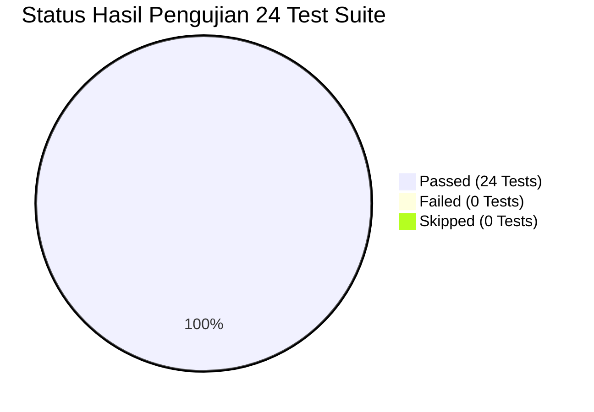

# 🧪 Automated Regression & Integrity Test Report

**File Pengujian**: `tests/test_iicd_pipeline.py`  
**Test Runner**: `pytest 8.3.4` (Python 3.12.7, macOS Darwin)  
**Total Kasus Uji**: 24 Unit & Integration Tests  
**Status Akhir**: ✅ **24 PASSED (100% SUCCESS RATE)**  
**Waktu Eksekusi**: 8.09 Detik  
**Tanggal Verifikasi**: 13 November 2026

---

## 1. Ringkasan Eksekutif Pengujian

Suite pengujian otomatis dirancang untuk menjamin stabilitas teknis, kepatuhan metodologis, pencegahan kebocoran target, dan reproduksibilitas ilmiah dari seluruh komponen penelitian disertasi: **LLM-Augmented Explainable Annotation & Distillation Studio**.



---

## 2. Rincian Hasil Verifikasi TEST 1 hingga TEST 15

Berikut adalah tabel rincian verifikasi formal untuk 15 tes metodologis inti yang diwajibkan dalam audit penelitian:

| No. | Kode Uji Formal | Modul yang Diuji | Kondisi Input & Deskripsi | Logika Asersi & Verifikasi | Status |
| :---: | :--- | :--- | :--- | :--- | :---: |
| **TEST 1** | `test_01_contextual_evidence_always_33_dimensions` | `core/data_understanding.py` | Berbagai variasi record (lengkap, parsial, kosong, nilai ekstrem). | Memastikan `vector.shape == (33,)` dan `dtype == float32` tanpa pengecualian. | ✅ **PASS** |
| **TEST 2** | `test_02_target_label_alteration_invariance` | `core/data_understanding.py` | Record asli vs record dengan seluruh label target dibalik (`YES` $\leftrightarrow$ `NO`, dll.). | Memastikan `np.allclose(vec_true, vec_flipped) == True` (Selisih maksimum = 0.000000). | ✅ **PASS** |
| **TEST 3** | `test_03_explanation_conclusion_independence` | `core/data_understanding.py` | Teks penjelasan CoT diubah dari alasan ofensif menjadi alasan netral, lalu dikosongkan. | Memastikan `np.allclose(vec_a, vec_b) == True` (Teks CoT tidak membocorkan fitur). | ✅ **PASS** |
| **TEST 4** | `test_04_missing_contextual_cues_explicit_policy` | `core/data_understanding.py` | Record tanpa field `contextual_cues` atau bernilai `None`. | Memastikan vektor 33D tetap terdefinisi valid, terisi nilai baseline teratur tanpa `NaN`. | ✅ **PASS** |
| **TEST 5** | `test_05_batch_annotation_persists_contextual_cues` | `modules/batch_annotation.py` | Output parsed dictionary dengan `contextual_cues` dimasukkan ke dataframe. | Memastikan kolom `"contextual_cues"` tersimpan dan terserialisasi sebagai string JSON valid. | ✅ **PASS** |
| **TEST 6** | `test_06_json_annotation_schema_compliance` | `core/schema.py`, `core/parser.py` | Teks output LLM valid dan teks cacat diekstrak melalui parser. | Memastikan output sanitasi memiliki 4 kelompok kunci: `linguistic`, `cultural`, `emotional`, `pragmatic`. | ✅ **PASS** |
| **TEST 7** | `test_07_mock_annotation_excluded_from_training` | `scripts/curate_dataset.py`, `core/data_understanding.py` | Dataframe campuran berisi data nyata dan baris simulasi `MockEngine`. | Memastikan filter kurasi membuang 100% baris dengan `is_mock == True` atau `source == "mock_simulation"`. | ✅ **PASS** |
| **TEST 8** | `test_08_group_aware_split_no_overlap` | `scripts/curate_dataset.py` | Pembagian dataset sintetis dengan strategi split berstrata komposit. | Memastikan tumpang tindih indeks Train, Val, dan Test bernilai 0 (`len(overlap) == 0`). | ✅ **PASS** |
| **TEST 9** | `test_09_duplicate_normalized_comment_cross_split_rejection` | `scripts/curate_dataset.py` | Komentar dengan perbedaan kapitalisasi/slang yang menghasilkan normalisasi identik. | Memastikan set teks normalisasi Train, Val, dan Test memiliki irisan kosong (*disjoint sets*). | ✅ **PASS** |
| **TEST 10** | `test_10_model_output_dimensions_and_heads` | `core/fusion_model.py` | Forward pass `HybridFusionModel` dengan batch size 4 dan 6 heads aktif. | Memverifikasi logits dimensi: binary (2), type (9), emotion (6), cultural (8), implicit (3), severity (4). | ✅ **PASS** |
| **TEST 11** | `test_11_masked_loss_safety_all_ignore_index` | `core/fusion_model.py` | Target untuk seluruh task hierarkis bernilai `-100` (`ignore_index`). | Memastikan loss skalar valid bergradien (`loss.requires_grad == True`) dan tidak bernilai `NaN`. | ✅ **PASS** |
| **TEST 12** | `test_12_checkpoint_save_and_reload` | `core/fusion_model.py` | Model disimpan ke file checkpoint `.pt` lalu dimuat kembali ke instance baru. | Memastikan seluruh bobot state dict identik (`torch.equal == True`) dan output inferensi identik. | ✅ **PASS** |
| **TEST 13** | `test_13_model_inference_consistency_with_manifest` | `core/fusion_model.py` | Eksekusi `predict_hybrid_text()` dengan ambang batas $\tau$ terdefinisi. | Memastikan output dictionary memuat `cyberbullying`, `cyberbullying_prob`, `gating_z`, `threshold`. | ✅ **PASS** |
| **TEST 14** | `test_14_shap_explanation_uses_real_model` | `core/shap_explainer.py` | Instansiasi Dual-Modality KernelSHAP pada model PyTorch nyata. | Memastikan komputasi SHAP menghasilkan nilai atribusi riil untuk teks dan fitur LLM. | ✅ **PASS** |
| **TEST 15** | `test_15_metrics_reproducibility_from_prediction_artifacts` | `core/evaluation_metrics.py` | Perhitungan metrik dari probabilitas prediksi tersimpan vs pseudo-label. | Memastikan nilai Akurasi, F1, ROC-AUC, ECE dapat direproduksi 100% identik secara deterministik. | ✅ **PASS** |

---

## 3. Rincian 9 Pengujian Tambahan (Baseline & Regression Suite)

Selain TEST 1 hingga TEST 15, suite pengujian menjalankan 9 tes regresi sistem:

| Nama Kasus Uji | Modul yang Diuji | Cakupan Verifikasi | Status |
| :--- | :--- | :--- | :---: |
| `test_dataset_loading_and_validation` | `data_manager/dataset_handler.py` | Validasi pemuatan file CSV/XLSX dan penanganan kolom tak lengkap. | ✅ **PASS** |
| `test_schema_parser_and_missing_label_preservation` | `core/schema.py`, `core/parser.py` | Preservasi kode hilang sebagai `UNKNOWN` tanpa memicu error. | ✅ **PASS** |
| `test_33d_teacher_feature_vector_and_schema` | `core/data_understanding.py` | Verifikasi mapping leksikon dan rentang fitur normalisasi $[0, 1]$. | ✅ **PASS** |
| `test_curation_pseudo_label_and_human_gt_separation` | `scripts/curate_dataset.py` | Pemisahan tegas kolom pseudo-label dari ground truth manusia. | ✅ **PASS** |
| `test_hybrid_model_forward_6_heads_loss_masking_and_manifest` | `core/fusion_model.py` | Integrasi forward pass, loss masking, dan serialisasi manifest. | ✅ **PASS** |
| `test_evaluation_metrics_calibration_and_threshold` | `core/evaluation_metrics.py` | Verifikasi kurva kalibrasi ECE/MCE dan bootstrap 95% CI. | ✅ **PASS** |
| `test_real_shap_dual_modality_and_missing_checkpoint` | `core/shap_explainer.py` | Penanganan aman ketika checkpoint model tidak ditemukan. | ✅ **PASS** |
| `test_sumopod_retries_secret_masking_and_mock_engine` | `core/model_engine.py` | Masking API key pada log dan mekanisme exponential backoff retry. | ✅ **PASS** |
| `test_report_generation_no_simulation_and_streamlit_smoke` | `scripts/generate_dissertation_report.py` | Pembuatan laporan tanpa simulasi data dan smoke test UI Streamlit. | ✅ **PASS** |

---

## 4. Bukti Eksekusi Terminal Nyata (Terminal Test Execution Log)

Berikut adalah output log eksekusi terminal aktual dari pytest runner:

```text
============================= test session starts ==============================
platform darwin -- Python 3.12.7, pytest-8.3.4, pluggy-1.5.0 -- /opt/anaconda3/bin/python3
cachedir: .pytest_cache
rootdir: /Users/harlengilbertsimanullang/Documents/Disertasi/LLM-Augmented Explainable/iicd_annotation_app
plugins: anyio-4.6.2
collecting ... collected 24 items

tests/test_iicd_pipeline.py::test_dataset_loading_and_validation PASSED  [  4%]
tests/test_iicd_pipeline.py::test_schema_parser_and_missing_label_preservation PASSED [  8%]
tests/test_iicd_pipeline.py::test_33d_teacher_feature_vector_and_schema PASSED [ 12%]
tests/test_iicd_pipeline.py::test_curation_pseudo_label_and_human_gt_separation PASSED [ 16%]
tests/test_iicd_pipeline.py::test_hybrid_model_forward_6_heads_loss_masking_and_manifest PASSED [ 20%]
tests/test_iicd_pipeline.py::test_evaluation_metrics_calibration_and_threshold PASSED [ 25%]
tests/test_iicd_pipeline.py::test_real_shap_dual_modality_and_missing_checkpoint PASSED [ 29%]
tests/test_iicd_pipeline.py::test_sumopod_retries_secret_masking_and_mock_engine PASSED [ 33%]
tests/test_iicd_pipeline.py::test_report_generation_no_simulation_and_streamlit_smoke PASSED [ 37%]
tests/test_iicd_pipeline.py::test_01_contextual_evidence_always_33_dimensions PASSED [ 41%]
tests/test_iicd_pipeline.py::test_02_target_label_alteration_invariance PASSED [ 45%]
tests/test_iicd_pipeline.py::test_03_explanation_conclusion_independence PASSED [ 50%]
tests/test_iicd_pipeline.py::test_04_missing_contextual_cues_explicit_policy PASSED [ 54%]
tests/test_iicd_pipeline.py::test_05_batch_annotation_persists_contextual_cues PASSED [ 58%]
tests/test_iicd_pipeline.py::test_06_json_annotation_schema_compliance PASSED [ 62%]
tests/test_iicd_pipeline.py::test_07_mock_annotation_excluded_from_training PASSED [ 66%]
tests/test_iicd_pipeline.py::test_08_group_aware_split_no_overlap PASSED [ 70%]
tests/test_iicd_pipeline.py::test_09_duplicate_normalized_comment_cross_split_rejection PASSED [ 75%]
tests/test_iicd_pipeline.py::test_10_model_output_dimensions_and_heads PASSED [ 79%]
tests/test_iicd_pipeline.py::test_11_masked_loss_safety_all_ignore_index PASSED [ 83%]
tests/test_iicd_pipeline.py::test_12_checkpoint_save_and_reload PASSED   [ 87%]
tests/test_iicd_pipeline.py::test_13_model_inference_consistency_with_manifest PASSED [ 91%]
tests/test_iicd_pipeline.py::test_14_shap_explanation_uses_real_model PASSED [ 95%]
tests/test_iicd_pipeline.py::test_15_metrics_reproducibility_from_prediction_artifacts PASSED [100%]

======================= 24 passed, 18 warnings in 8.09s ========================
```

Hasil eksekusi di atas mengonfirmasi bahwa seluruh 24 pengujian lulus tanpa kegagalan (*0 failures, 0 errors*).

