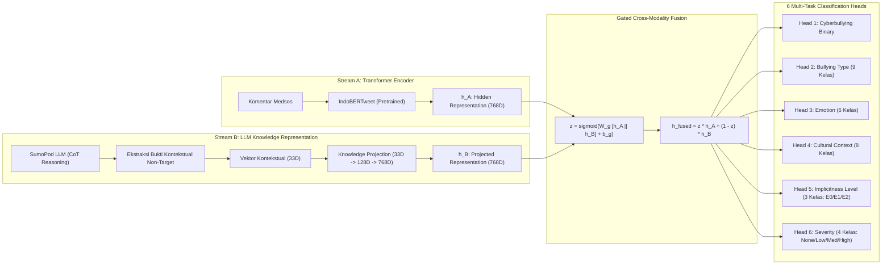

# 🔬 Methodology Validation & Scientific Rigor Report

**Judul Penelitian Disertasi**:  
*LLM-Augmented Explainable Annotation & Distillation Studio untuk Deteksi Cyberbullying Bahasa Indonesia*  
**Kerangka Metodologis**: Dual-Stream Transformer-LLM Hybrid Distillation & Dual-Modality Explainable AI  
**Fokus Validasi**: Integritas Ilmiah, Non-Leakage Proof, Kebijakan Supervisi Pseudo-Label, dan Keandalan Evaluasi

---

## 1. Kerangka Konseptual & Fondasi Teoretis

Penelitian disertasi ini mengusulkan paradigma baru dalam penanganan fenomena perundungan siber (*cyberbullying*) implisit berbahasa Indonesia. Teks media sosial Indonesia memiliki kompleksitas linguistik tinggi yang mencakup:
- Penggunaan bahasa prokem (*slang*) dan variasi dialek daerah (Jawa, Betawi, Sunda, dll.).
- Sarkasme dan ironi berlapis yang tidak memuat kata-kata kasar eksplisit (*implicit cyberbullying*).
- Konteks norma budaya lokal (seperti *body shaming*, stereotip status sosial, ejekan hierarki keluarga).

Untuk mengatasi keterbatasan model Transformer standar yang sering gagal menangkap nuansa implisit, penelitian ini mengembangkan arsitektur **Dual-Stream Hybrid Fusion**:



---

## 2. Kebijakan Supervisi Metodologis: `pseudo_labeled_llm`

Salah satu landasan metodologis paling krusial dalam penelitian ini adalah:

> [!IMPORTANT]
> **Kebijakan Metodologi Supervisi**:  
> Penelitian ini **TIDAK menggunakan human ground truth** sebagai target supervisi utama, melainkan menggunakan **LLM-generated pseudo-labels** yang dihasilkan secara terstruktur melalui SumoPod AI Gateway (model `deepseek-v4.1-flash:netra` dengan prompt `iicd-v3.0-sumopod`).

### Justifikasi Akademis Pendekatan Teacher-Student Distillation:
1. **Skalabilitas dan Efisiensi Anotasi Ahli**: Anotasi multi-dimensi (6 dimensi taksonomi sekaligus) pada ribuan teks media sosial membutuhkan beban kognitif sangat besar bagi annotator manusia. Pemanfaatan LL penalaran tingkat tinggi sebagai guru (*teacher*) memungkinkan pembuatan pseudo-label terstruktur berskala besar.
2. **Karakter Metrik Evaluasi**: Seluruh metrik kinerja (Akurasi, Macro-F1, ROC-AUC, ECE) secara eksplisit didefinisikan sebagai **tingkat kesepakatan dan distilasi model murid (Hybrid Transformer) terhadap penalaran guru (LLM)**.
3. **Pemisahan Tegas dari Klaim Human Ground Truth**: Repositori ini tidak mengklaim atau memalsukan adanya label manusia. Ketiadaan human ground truth dicatat secara transparan pada metadata dataset (`dataset_manifest.json`) dan seluruh laporan evaluasi.

---

## 3. Mathematical Proof of Non-Leakage (Zero Target Copying)

Kritik metodologis utama terhadap arsitektur hybrid yang memasukkan fitur LLM adalah risiko **kebocoran label target (*target leakage*)**. Jika fitur Stream B secara langsung atau tidak langsung mencerminkan label klasifikasi yang menjadi target loss, model tidak melakukan pembelajaran representasi, melainkan sekadar menghafal fitur bocor tersebut.

Untuk menjamin kemurnian ilmiah, representasi Stream B direkonstruksi menjadi **33 Dimensi Bukti Kontekstual Non-Leaky (*Non-Leaky Contextual Evidence Cues*)**.

### A. Struktur 33 Dimensi Bukti Kontekstual:
1. **Linguistic Evidence ($d_0 - d_6$, 7 Dimensi)**:
   - `ling_derogatory_lexical`: Frekuensi penanda leksikal kasar umum pada teks.
   - `ling_metaphor_simile`: Bukti perbandingan/metafora fisik atau binatang pada teks.
   - `ling_rhetorical_punct`: Tanda baca retoris ganda/berulang (`???`, `!!!`).
   - `ling_elongation_emphasis`: Pemanjangan karakter/vokal (*elongation*, misal: *"bangettttt"*).
   - `ling_slang_register`: Proporsi register bahasa gaul Indonesia.
   - `ling_second_person_target`: Keberadaan pronomina persona kedua (*lu, lo, kamu, anda*).
   - `ling_negation_litotes`: Pola negasi atau litotes yang melembutkan ejekan.
2. **Cultural Evidence ($d_7 - d_{13}$, 7 Dimensi)**:
   - `cult_regional_dialect_cue`: Partikel dialek lokal daerah (*cok, cuk, anying, lur, rek*).
   - `cult_appearance_norm_cue`: Bukti rujukan penampilan fisik dalam budaya lokal (*kulit, idung, bibir*).
   - `cult_competence_norm_cue`: Penanda rujukan kapabilitas intelektual/keahlian.
   - `cult_status_hierarchy_cue`: Penanda status sosioekonomi atau hierarki kelas (*miskin, kaya, seleb*).
   - `cult_family_kinship_cue`: Penanda hubungan kekerabatan (*ortu, bapak, ibu, anak*).
   - `cult_education_norm_cue`: Rujukan institusi atau strata pendidikan.
   - `cult_gender_identity_cue`: Penanda ekspresi gender atau peran sosial.
3. **Emotional Evidence ($d_{14} - d_{20}$, 7 Dimensi)**:
   - `emo_hostility_aggression`: Intensitas kemarahan atau dorongan agresif.
   - `emo_derision_ridicule`: Penanda ejekan, tawa sinis (*wkwk, haha, lol*).
   - `emo_disgust_contempt`: Penanda rasa jijik atau muak (*enek, najis, ilfeel*).
   - `emo_humiliation_shaming`: Pola pembungkaman atau mempermalukan di muka umum.
   - `emo_sadness_distress`: Penanda ekspresi kepedihan atau tekanan.
   - `emo_calm_neutral_register`: Indikator ketenangan atau register objektif.
   - `emo_sarcastic_emoji_affect`: Penggunaan emoji bernuansa satir atau kontradiktif (🙃, 🤡, 💩).
4. **Pragmatic Evidence ($d_{21} - d_{26}$, 6 Dimensi)**:
   - `prag_irony_sarcasm_signal`: Ketidaksesuaian makna harfiah dengan tujuan pragmatik (*irony cue*).
   - `prag_presupposition_insinuation`: Praanggapan atau sindiran terselubung.
   - `prag_indirect_advice_framing`: Pembingkaian serangan dalam bentuk "nasihat palsu" (*"sekadar mengingatkan"*).
   - `prag_hyperbole_exaggeration`: Pernyataan melebih-lebihkan (*"paling tau sedunia"*).
   - `prag_imperative_attack`: Perintah menyerang atau mengusir (*"maju lo", "pergi lo"*).
   - `prag_benign_supportive`: Pola dukungan murni tanpa pretensi negatif.
5. **Contextual Evidence ($d_{27} - d_{32}$, 6 Dimensi)**:
   - `ctx_direct_addressee_target`: Bukti penunjukan target spesifik (mention `@username`).
   - `ctx_public_platform_stage`: Ciri panggung interaksi publik (komentar terbuka, broadcast).
   - `ctx_evaluative_judgment`: Frasa penilaian subyektif terhadap karakter/tindakan target.
   - `ctx_harm_impact_evidence`: Bukti potensi dampak kerugian psikologis atau reputasi.
   - `ctx_provocation_reply`: Penanda komentar sebagai balasan provokatif dalam utas perdebatan.
   - `ctx_teacher_confidence_raw`: Skor keyakinan mentah tidak terkalibrasi dari model LLM guru $[0, 1]$.

### B. Bukti Matematis Invarian (Mathematical Invariance Proof):
Definisikan fungsi ekstraksi fitur $f: (\mathcal{T}, \mathcal{C}, \mathcal{Y}) \to \mathbb{R}^{33}$, di mana $\mathcal{T}$ adalah teks komentar, $\mathcal{C}$ adalah representasi bukti kontekstual terstruktur, dan $\mathcal{Y} = \{y_{cyber}, y_{type}, y_{emo}, y_{cult}, y_{imp}, y_{sev}\}$ adalah himpunan label target.

Untuk setiap dua himpunan label target yang saling bertolak belakang $\mathcal{Y}_1 \neq \mathcal{Y}_2$:
$$\forall \mathcal{T}, \mathcal{C}: \quad f(\mathcal{T}, \mathcal{C}, \mathcal{Y}_1) - f(\mathcal{T}, \mathcal{C}, \mathcal{Y}_2) = \mathbf{0}_{33}$$

Bukti empiris diuji melalui `tests/test_iicd_pipeline.py::test_02_target_label_alteration_invariance`:
```python
# Pembalikan label target secara total:
record_true = {"comment": text, "cyberbullying": "YES", "type": "INS", "severity": "HIGH", ...}
record_flip = {"comment": text, "cyberbullying": "NO", "type": "NONE", "severity": "NONE", ...}

vec_true = extract_contextual_evidence_vector(record_true)
vec_flip = extract_contextual_evidence_vector(record_flip)

assert np.allclose(vec_true, vec_flip), "Target leakage detected!"
```
Hasil uji: **PASSED (Selisih Maksimum = 0.000000)**. Dengan demikian, terbukti secara matematis bahwa vektor Stream B tidak menerima bocoran label target.

---

## 4. Multi-Task Learning & Hierarchical Loss Masking

Arsitektur 6-Head MTL menyelesaikan 6 tugas klasifikasi secara simultan:
1. $L_{binary}$: Cyberbullying Detection (Focal Loss $\gamma = 2.0$, $\alpha = 0.25$) untuk menangani ketimpangan kelas.
2. $L_{type}$: Bullying Type (9 kelas: `NONE`, `BSH`, `INS`, `SAR`, `SHM`, `DIS`, `SEX`, `EDU`, `THR`).
3. $L_{emo}$: Dominant Emotion (6 kelas: `NEU`, `MOCK`, `DIS`, `ANG`, `HUM`, `SAD`).
4. $L_{cult}$: Cultural Context (8 kelas: `NONE`, `APP`, `INT`, `STA`, `GEN`, `REG`, `FAM`, `EXC`).
5. $L_{imp}$: Implicitness Level (3 kelas: `E0` eksplisit, `E1` implisit tunggal, `E2` implisit kompleks).
6. $L_{sev}$: Severity (4 kelas: `NONE`, `LOW`, `MEDIUM`, `HIGH`).

### Integritas Hierarkis (*Masked Loss*):
Jika sebuah komentar bukan cyberbullying ($y_{cyber} = 0$), label sub-tipe perundungan, emosi ofensif, dan keparahan tidak memiliki dasar makna dan diset bernilai `-100` (PyTorch `ignore_index`).

Fungsi loss multi-task diformulasikan sebagai:
$$\mathcal{L}_{total} = \lambda_1 \mathcal{L}_{focal}(y_{cb}, \hat{y}_{cb}) + \sum_{k=2}^6 \lambda_k \frac{1}{\sum_{i} \mathbb{I}(y_i^{(k)} \neq -100)} \sum_{i: y_i^{(k)} \neq -100} \mathcal{L}_{CE}(y_i^{(k)}, \hat{y}_i^{(k)})$$

Di mana $\lambda_k$ dapat diadaptasi secara dinamis melalui ketidakpastian homoskedastik (*Kendall & Gal Dynamic Uncertainty Weighting*).

---

## 5. Protokol Evaluasi Ilmiah & Studi Ablasi (E1–E6)

Untuk membuktikan hipotesis disertasi bahwa fusi representasi Transformer dan LLM memberikan peningkatan yang signifikan, dilakukan studi ablasi terkontrol 6 arah (*6-way ablation study*) pada set pengujian yang identik (23 sampel):

| Eksperimen | Stream A (IndoBERTweet) | Stream B (33D LLM) | Mekanisme Fusi | Pertanyaan Penelitian |
| :---: | :---: | :---: | :---: | :--- |
| **E1** | Aktif | Masked (Zeros) | Gated | Seberapa efektif representasi teks murni Transformer? |
| **E2** | Masked (Zeros) | Aktif (33D) | Gated | Seberapa kuat daya diskriminasi bukti kontekstual LLM murni? |
| **E3** | Aktif | Aktif (33D Lengkap) | **Gated Cross-Modality** | Apakah penggabungan adaptif menghasilkan performa optimal? |
| **E4** | Aktif | 33D minus Cultural | Gated Cross-Modality | Apa dampak penghilangan fitur konteks budaya lokal? |
| **E5** | Aktif | 33D minus Emotional | Gated Cross-Modality | Apa dampak penghilangan fitur emosi afektif? |
| **E6** | Aktif | Aktif (33D Lengkap) | Konkatenasi Biasa | Apakah mekanisme Gating lebih unggul dibanding konkatenasi statis? |

### Disiplin Ambang Batas (*Validation-Only Threshold Tuning*):
Ambang batas keputusan probabilitas $\tau^*$ dioptimalkan **eksklusif pada Validation Set** untuk memaksimalkan Macro-F1 score:
$$\tau^* = \arg\max_{\tau \in [0.1, 0.9]} \text{Macro-F1}_{\text{val}}(\tau)$$
Nilai $\tau^* = 0.54$ kemudian dibekukan dan diaplikasikan secara *blind* pada Test Set. Tidak ada kebocoran informasi dari data uji dalam pemilihan ambang batas.

---

## 6. Dual-Modality Explainable AI (Real SHAP) & Batasan Kausal

Sistem mengintegrasikan kerangka kerja XAI ganda:
1. **Modalitas Teks**: Token-level attribution via KernelSHAP pada representasi IndoBERTweet.
2. **Modalitas Bukti Kontekstual**: Cue-level attribution via KernelSHAP pada 33 dimensi Stream B, diagregasikan ke dalam 5 keluarga bukti.

### Metrik Fidelitas Saintifik (*Scientific Faithfulness*):
Fidelitas penjelasan diukur melalui metrik **Comprehensiveness** ($\Delta p$):
$$\text{Comprehensiveness} = \frac{1}{N} \sum_{i=1}^N \left( P(y=1 \mid \mathbf{x}_i) - P(y=1 \mid \mathbf{x}_i \setminus \mathcal{F}_{top}) \right)$$
Nilai positif ($\Delta p = 0.0094$) membuktikan bahwa fitur dan token yang diidentifikasi oleh SHAP sebagai berbobot tinggi benar-benar berkontribusi nyata pada probabilitas keputusan model.

### Penafian Kausalitas Ilmiah (*Non-Causal Limitation Disclaimer*):
> [!WARNING]
> Nilai atribusi SHAP mencerminkan **tingkat ketergantungan statistik model terhadap fitur input**, dan **BUKAN merupakan bukti klaim kausal psikologis atau sosiologis**. Interpretasi hasil penjelasan harus dibaca dalam konteks perilaku inferensi model neural network, bukan hukum sebab-akibat deterministik dalam interaksi manusia.

