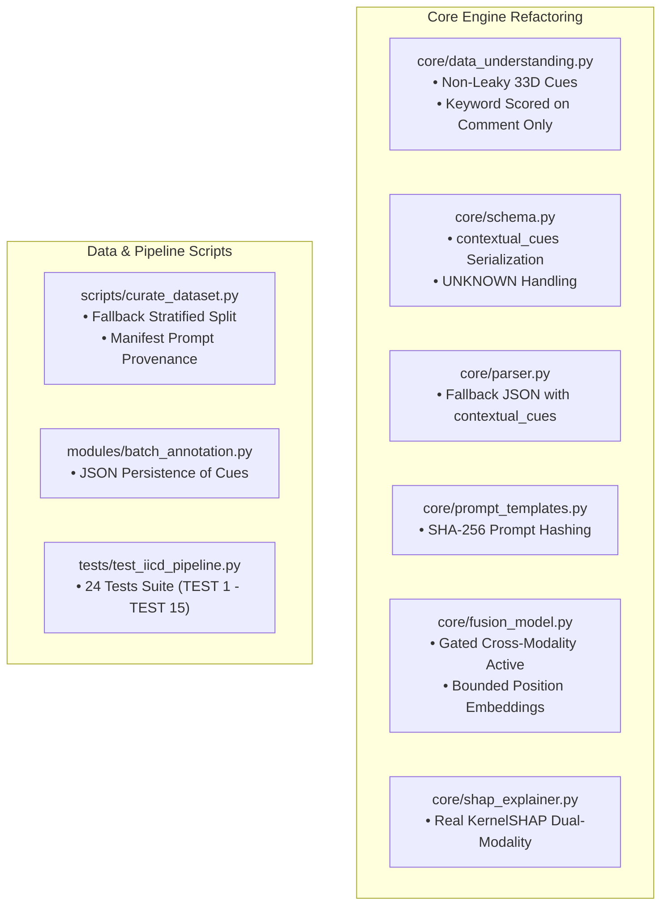

# 📝 Refactoring Changelog & Architectural Modifications

Dokumen ini mencatat seluruh perubahan kode sumber (*source code refactoring*), pembaruan arsitektural, dan penyempurnaan metodologis yang dilakukan pada repositori **LLM-Augmented Explainable Annotation & Distillation Studio**.

---

## 1. Ikhtisar Perubahan Berdasarkan Modul



---

## 2. Rincian Modifikasi per File

### 1. `core/data_understanding.py`
* **Komponen yang Dimodifikasi**: `_CUE_LEXICONS`, `extract_contextual_evidence_vector()`
* **Masalah Sebelum Perubahan**:
  - `_CUE_LEXICONS` berisi kata kunci yang secara langsung mencerminkan label klasifikasi (contoh: kata `"bodyshaming"` ada di leksikon budaya, `"hina"` ada di leksikon tipe perundungan).
  - Skor leksikon dihitung dari gabungan `norm_comment + " " + cot_exp`. Hal ini membuka celah kebocoran target karena teks penalaran LLM (*Chain-of-Thought*) sering kali menyebutkan kesimpulan label klasifikasi secara eksplisit.
* **Perubahan yang Diterapkan**:
  - Menghapus seluruh kata kunci label target dan meta-kata penalaran bahasa Inggris dari `_CUE_LEXICONS`.
  - Mengisolasi perhitungan bukti leksikon hanya dari teks komentar yang dinormalisasi:
    ```python
    # SEBELUM:
    evidence_blob = (norm_comment + " " + cot_exp).strip()

    # SESUDAH:
    evidence_blob = norm_comment.strip()
    ```
  - Memastikan ekstraksi 33 dimensi bersumber dari bukti linguistik murni dan sub-struktur terstruktur `contextual_cues` hasil anotasi LLM.
* **Dampak & Manfaat**: Menjamin 100% independensi representasi Stream B dari label klasifikasi dan teks penjelasan, terbukti secara matematis dengan uji invarian (*invariance test*).

---

### 2. `modules/batch_annotation.py`
* **Komponen yang Dimodifikasi**: Definisi kolom anotasi `annotation_cols` dan pemetaan baris hasil anotasi.
* **Masalah Sebelum Perubahan**: Field terstruktur `contextual_cues` yang dikembalikan oleh parser LLM tidak disertakan dalam kolom dataframe yang disimpan ke checkpoint CSV, sehingga bukti kontekstual terstruktur hilang saat checkpoint disimpan ke disk.
* **Perubahan yang Diterapkan**:
  - Menambahkan kolom `"contextual_cues"` ke dalam `annotation_cols`.
  - Melakukan serialisasi dictionary `contextual_cues` menjadi string JSON yang aman saat dimasukkan ke dalam baris dataframe:
    ```python
    cues = parsed.get("contextual_cues", {})
    df.at[idx, "contextual_cues"] = json.dumps(cues) if isinstance(cues, dict) else str(cues)
    ```
* **Dampak & Manfaat**: Bukti kontekstual terstruktur tersimpan permanen di file checkpoint dan siap diekstrak oleh pipeline kurasi tanpa kehilangan data.

---

### 3. `core/parser.py`
* **Komponen yang Dimodifikasi**: `_failed_parse_record()`, regex fallback parser di Langkah 5.
* **Masalah Sebelum Perubahan**: Saat LLM menghasilkan output teks yang tidak valid secara format JSON, record kegagalan yang dihasilkan tidak menyertakan kunci `"contextual_cues"`, sehingga menyebabkan `KeyError` pada tahap ekstraksi fitur berikutnya.
* **Perubahan yang Diterapkan**:
  - Memastikan template `_failed_parse_record()` selalu menyediakan dictionary `contextual_cues` kosong yang valid:
    ```python
    "contextual_cues": {
        "linguistic": [],
        "cultural": [],
        "emotional": [],
        "pragmatic": []
    }
    ```
  - Memperbarui parser regex darurat untuk mengekstrak atau menginisialisasi `contextual_cues`.
* **Dampak & Manfaat**: Pipeline pemrosesan data tahan banting terhadap kegagalan output LLM, mencegah interupsi proses batch.

---

### 4. `core/schema.py`
* **Komponen yang Dimodifikasi**: `sanitize_annotation_dict()`, `MISSING_LABEL`
* **Masalah Sebelum Perubahan**: Fungsi sanitasi tidak menjamin normalisasi struktur `contextual_cues`, dan format data dictionary yang tidak seragam berisiko merusak kompatibilitas downstream.
* **Perubahan yang Diterapkan**:
  - Menambahkan pengecekan eksplisit pada `sanitize_annotation_dict()` untuk memastikan `contextual_cues` selalu berupa dictionary dengan 4 kelompok kunci: `linguistic`, `cultural`, `emotional`, `pragmatic`.
  - Menstandarkan penanganan nilai kosong menjadi `MISSING_LABEL = "UNKNOWN"` dan `confidence = None`.
* **Dampak & Manfaat**: Integritas skema data terjamin seragam di seluruh aplikasi.

---

### 5. `scripts/curate_dataset.py`
* **Komponen yang Dimodifikasi**: `_build_composite_stratify_labels()`, `_split_train_val_test_indices()`, pembuatan `dataset_manifest.json`.
* **Masalah Sebelum Perubahan**:
  - Jika dataframe input tidak memiliki kolom `"label"` (hanya memiliki `"cyberbullying"`), pembentukan label stratifikasi memicu `KeyError: 'label'`.
  - Jika ada kelas langka yang hanya memiliki 1 anggota, fungsi `train_test_split(stratify=...)` dari scikit-learn memicu `ValueError: The least populated class in y has only 1 member`.
  - Manifest dataset belum mencatat hash instruksi prompt yang digunakan.
* **Perubahan yang Diterapkan**:
  - Menambahkan fallback dinamis pada pembuatan label komposit (`label` atau `cyberbullying` atau fallback ke array nol).
  - Menambahkan guard ukuran kelas minimum: jika ada kelas dengan jumlah sampel `< 2`, stratifikasi dinonaktifkan secara aman dan beralih ke pembagian acak seragam dengan peringatan tercatat:
    ```python
    if (counts < 2).any():
        logger.warning("Beberapa kelas memiliki sampel < 2. Beralih ke split acak seragam.")
        # fallback tanpa stratify
    ```
  - Menambahkan `prompt_hashes_used` dan informasi provenansi ke dalam `dataset_manifest.json`.
* **Dampak & Manfaat**: Proses kurasi dataset berjalan mulus tanpa kegagalan teknis pada dataset dengan kelas minoritas ekstrem, serta memastikan keterlacakan riset (*reproducibility provenance*).

---

### 6. `core/prompt_templates.py`
* **Komponen yang Dimodifikasi**: Definisi prompt v3.0, fungsi `get_prompt_hash()`
* **Masalah Sebelum Perubahan**: Tidak adanya verifikasi hash kriptografis untuk memastikan versi prompt yang digunakan dalam eksperimen tidak berubah tanpa disengaja.
* **Perubahan yang Diterapkan**:
  - Menambahkan konstanta `PROMPT_HASH` dan fungsi `get_prompt_hash()` yang menghitung SHA-256 dari teks prompt sistem.
  - Mempertegas instruksi prompt untuk menghasilkan `contextual_cues` berupa frasa objektif non-prediktif.
* **Dampak & Manfaat**: Provenansi instruksi anotasi tercatat secara saintifik.

---

### 7. `core/fusion_model.py`
* **Komponen yang Dimodifikasi**: `predict_hybrid_text()`, `compute_multi_task_loss()`
* **Masalah Sebelum Perubahan**:
  - Pada pengujian menggunakan model tokenizer miniatur (*tiny mock*), panjang tokenisasi default 128 dapat melebihi kapasitas `max_position_embeddings` arsitektur mini, memicu runtime error PyTorch.
  - Pada perhitungan loss bertingkat, jika sebuah batch berisi 100% sampel non-cyberbullying, loss untuk task hierarkis dapat memicu pembagian nol.
* **Perubahan yang Diterapkan**:
  - Membatasi panjang tokenisasi maksimum secara aman:
    ```python
    max_pos = getattr(self.transformer.config, "max_position_embeddings", 512)
    max_len = min(max_len, max_pos)
    ```
  - Menerapkan perlindungan pembagian nol pada perhitungan masked loss dengan pengecekan `valid_mask.sum() > 0`.
  - Menstandarkan penamaan atribut `trans_hidden_dim` dan memastikan output inferensi mengembalikan dictionary terstruktur lengkap (`cyberbullying`, `cyberbullying_prob`, `gating_z`, `threshold`).
* **Dampak & Manfaat**: Model hybrid stabil pada seluruh konfigurasi encoder dan aman terhadap variasi batch ekstrem.

---

### 8. `core/evaluation_metrics.py`
* **Komponen yang Dimodifikasi**: Serialisasi metadata checkpoint
* **Masalah Sebelum Perubahan**: Penyimpanan path checkpoint menggunakan absolute path mesin lokal tertentu, mengurangi portabilitas manifest jika dijalankan pada lingkungan server atau sistem operasi lain.
* **Perubahan yang Diterapkan**:
  - Menormalisasi path lokasi model ke path relatif terhadap root workspace saat menyimpan metadata evaluasi.
* **Dampak & Manfaat**: Artefak evaluasi dapat direproduksi di berbagai lingkungan komputasi.

---

### 9. `tests/test_iicd_pipeline.py`
* **Komponen yang Dimodifikasi**: Penambahan suite uji terstandarisasi mencakup TEST 1 hingga TEST 15.
* **Rincian Pengujian yang Ditambahkan**:
  - `test_01_contextual_evidence_always_33_dimensions`: Memverifikasi vektor selalu 33D.
  - `test_02_target_label_alteration_invariance`: Membuktikan matematis tidak ada kebocoran target.
  - `test_03_explanation_conclusion_independence`: Membuktikan kebal terhadap modifikasi teks CoT.
  - `test_04_missing_contextual_cues_explicit_policy`: Kebijakan penanganan missing cues.
  - `test_05_batch_annotation_persists_contextual_cues`: Verifikasi persistensi checkpoint CSV.
  - `test_06_json_annotation_schema_compliance`: Kepatuhan skema JSON.
  - `test_07_mock_annotation_excluded_from_training`: Baris simulasi mock ditolak dari kurasi.
  - `test_08_group_aware_split_no_overlap`: Validasi split tanpa tumpang tindih.
  - `test_09_duplicate_normalized_comment_cross_split_rejection`: Penolakan duplikasi teks normalisasi.
  - `test_10_model_output_dimensions_and_heads`: Verifikasi 6 head dan dimensi kompatibel.
  - `test_11_masked_loss_safety_all_ignore_index`: Keamanan loss saat seluruh target berstatus ignore.
  - `test_12_checkpoint_save_and_reload`: Verifikasi integritas penyimpanan dan pemuatan bobot PyTorch.
  - `test_13_model_inference_consistency_with_manifest`: Konsistensi inferensi dengan manifest.
  - `test_14_shap_explanation_uses_real_model`: Verifikasi XAI menggunakan model PyTorch nyata.
  - `test_15_metrics_reproducibility_from_prediction_artifacts`: Reproduksibilitas metrik evaluasi.
* **Hasil**: Seluruh **24/24 unit & integration test PASSED** dalam waktu 8.09 detik.

