# 🔄 Comprehensive Research Reproducibility Guide

Panduan ini mendokumentasikan prosedur langkah-demi-langkah (*step-by-step*) untuk mereproduksi seluruh eksperimen, pelatihan model, evaluasi metrik, dan pengujian artefak dalam disertasi:
**"LLM-Augmented Explainable Annotation & Distillation Studio untuk Deteksi Cyberbullying Bahasa Indonesia"**.

---

## 1. Persyaratan Sistem & Lingkungan Eksekusi

### A. Perangkat Keras & Lunak
* **Sistem Operasi**: macOS (Apple Silicon / Intel) atau Linux (Ubuntu 20.04/22.04 LTS).
* **Python**: Python 3.10, 3.11, atau 3.12 (Diuji pada Python 3.12.7 via Anaconda/Miniconda).
* **Akselerator Komputasi**: Apple Silicon MPS (`mps`), NVIDIA CUDA (`cuda`), atau CPU.

### B. Instalasi Dependensi
Jalankan perintah berikut di lingkungan virtual Anda:

```bash
# 1. Clone repository (atau navigasi ke root direktori proyek)
cd iicd_annotation_app

# 2. Pastikan dependensi terpasang lengkap
pip install -r requirements.txt
```

### C. Konfigurasi Kredensial API SumoPod
Sistem menggunakan SumoPod AI Gateway untuk mengakses model LLM guru (`deepseek-v4.1-flash:netra`). Konfigurasikan API key pada environment variable:

```bash
# Menyetel API Key pada sesi terminal
export SUMOPOD_API_KEY="your-actual-sumopod-api-key-here"

# Opsi alternatif: Menyetel di file .env pada root direktori
echo "SUMOPOD_API_KEY=your-actual-sumopod-api-key-here" > .env
```

---

## 2. Alur Eksekusi Eksperimen Ujung-ke-Ujung (End-to-End CLI Pipeline)

Eksekusi pipeline penelitian dapat dijalankan secara berurutan menggunakan perintah CLI berikut:

```mermaid
flowchart LR
    S1["1. Curate Dataset<br/><code>scripts/curate_dataset.py</code>"] --> S2["2. Train Baseline<br/><code>scripts/train_indobertweet.py</code>"]
    S2 --> S3["3. Train Hybrid & Ablation<br/><code>scripts/train_hybrid_fusion.py</code>"]
    S3 --> S4["4. Dual-XAI Evaluation<br/><code>scripts/evaluate_dual_xai.py</code>"]
    S4 --> S5["5. Consistency Suite<br/><code>scripts/evaluate_consistency.py</code>"]
    S5 --> S6["6. Dissertation Report<br/><code>scripts/generate_dissertation_report.py</code>"]
    S6 --> S7["7. Automated Verification<br/><code>pytest tests/test_iicd_pipeline.py</code>"]
```



### Langkah 1: Kurasi Dataset, Pembersihan & Pemisahan Split Bebas Kebocoran
Memeriksa missing values, menghapus duplikasi, mengekstrak 33D *contextual evidence vector*, dan membuat pembagian Train (80%), Val (10%), Test (10%):

```bash
python scripts/curate_dataset.py \
    --input output/checkpoints/checkpoint_Dataset-Research.csv \
    --output output/final/iicd_cleaned_indobertweet.csv \
    --output-dir output/final \
    --train-ratio 0.80 \
    --val-ratio 0.10 \
    --test-ratio 0.10 \
    --random-state 42
```
*Artefak yang dihasilkan*:
- `output/final/iicd_cleaned_indobertweet.csv` (Dataset terkurasi 226 baris)
- `output/final/train.csv`, `output/final/val.csv`, `output/final/test.csv`
- `output/final/train_llm_vectors.npy`, `output/final/val_llm_vectors.npy`, `output/final/test_llm_vectors.npy`
- `output/final/dataset_manifest.json`
- `output/final/failed_annotations_log.json`

---

### Langkah 2: Pelatihan Baseline IndoBERTweet (Stream A Murni)
Melatih model Transformer encoder murni untuk klasifikasi biner dan melakukan pencarian ambang batas optimal ($\tau^*$) pada Validation Set:

```bash
python scripts/train_indobertweet.py \
    --train-data output/final/train.csv \
    --val-data output/final/val.csv \
    --test-data output/final/test.csv \
    --output-dir output/models/indobertweet_cyberbullying \
    --epochs 5 \
    --batch-size 8 \
    --lr 2e-5 \
    --tune-threshold
```
*Hasil*: Akurasi Test Set **73.91%**, Macro-F1 **0.6920**, ROC-AUC **0.8036** pada $\tau^* = 0.62$.

---

### Langkah 3: Pelatihan Dual-Stream Hybrid Fusion & Studi Ablasi 6-Arah (E1–E6)
Melatih arsitektur Hybrid Fusion 6-Head MTL dan mengeksekusi 6 konfigurasi ablasi pada test set identik:

```bash
python scripts/train_hybrid_fusion.py \
    --train-data output/final/train.csv \
    --val-data output/final/val.csv \
    --test-data output/final/test.csv \
    --train-vectors output/final/train_llm_vectors.npy \
    --val-vectors output/final/val_llm_vectors.npy \
    --test-vectors output/final/test_llm_vectors.npy \
    --output-dir output/models/hybrid_fusion_indobertweet \
    --epochs 5 \
    --batch-size 8 \
    --lr 2e-5 \
    --fusion-mode gated \
    --run-ablation
```
*Artefak yang dihasilkan*:
- `output/models/hybrid_fusion_indobertweet/best_hybrid_model.pt` (Bobot model terbaik)
- `output/models/hybrid_fusion_indobertweet/model_manifest.json` (Manifest parameter & gating)
- `output/models/hybrid_fusion_indobertweet/hybrid_test_metrics.json` (Metrik uji E3)
- `output/models/hybrid_fusion_indobertweet/ablation_comparison.json` (Perbandingan lengkap E1–E6)

---

### Langkah 4: Evaluasi Dual-Modality Explainable AI (Real SHAP)
Menghitung nilai atribusi KernelSHAP nyata untuk token teks (Stream A) dan 5 keluarga bukti kontekstual (Stream B), serta mengukur metrik *Comprehensiveness*:

```bash
python scripts/evaluate_dual_xai.py \
    --model-path output/models/hybrid_fusion_indobertweet/best_hybrid_model.pt \
    --test-data output/final/test.csv \
    --test-vectors output/final/test_llm_vectors.npy \
    --output-file output/evaluation_report/dual_xai_evaluation.json \
    --max-samples 20
```
*Artefak yang dihasilkan*:
- `output/evaluation_report/dual_xai_evaluation.json` (Atribusi SHAP dan $\Delta p = 0.0094$)
- `output/evaluation_report/table_dual_xai_breakdown.tex` (Tabel LaTeX XAI Bab 4)

---

### Langkah 5: Evaluasi Konsistensi Pseudo-Label & Kesepakatan Guru-Murid
Mengevaluasi kesepakatan prediksi murid vs guru (*Cohen's Kappa*) dan audit ketimpangan kelas non-GT:

```bash
python scripts/evaluate_consistency.py \
    --dataset output/final/iicd_cleaned_indobertweet.csv \
    --test-data output/final/test.csv \
    --test-vectors output/final/test_llm_vectors.npy \
    --model-path output/models/hybrid_fusion_indobertweet/best_hybrid_model.pt \
    --output output/evaluation_report/consistency_evaluation.json
```
*Artefak yang dihasilkan*:
- `output/evaluation_report/consistency_evaluation.json`

---

### Langkah 6: Pembuatan Laporan Evaluasi Disertasi & Tabel LaTeX Bab 4
Menghasilkan grafik publikasi 300 DPI dan tabel LaTeX otomatis:

```bash
python scripts/generate_dissertation_report.py \
    --metrics-file output/models/hybrid_fusion_indobertweet/hybrid_test_metrics.json \
    --ablation-file output/models/hybrid_fusion_indobertweet/ablation_comparison.json \
    --xai-file output/evaluation_report/dual_xai_evaluation.json \
    --output-dir output/evaluation_report
```
*Artefak yang dihasilkan*:
- `output/evaluation_report/dissertation_evaluation_report.md`
- `output/evaluation_report/dissertation_tables.tex`
- `output/evaluation_report/figure_confusion_matrix.png` (300 DPI)
- `output/evaluation_report/figure_implicitness_accuracy.png` (300 DPI)

---

### Langkah 7: Menjalankan Suite Pengujian Regresi Otomatis
Memverifikasi 24 unit & integration tests (termasuk TEST 1 hingga TEST 15):

```bash
pytest tests/test_iicd_pipeline.py -v
```
*Kondisi Lolos*: `24 passed, 18 warnings in ~8.1s`.

---

### Langkah 8: Menjalankan Dashboard Studio Streamlit
Menjalankan antarmuka grafis Studio Interaktif:

```bash
streamlit run app.py
```
Akses melalui peramban web di `http://localhost:8501`.

---

## 3. Pemuatan Model & Inferensi Programatik (Python Code Snippet)

Untuk menggunakan model checkpoint hasil pelatihan (`best_hybrid_model.pt`) secara programatik dalam kode Python:

```python
import torch
from transformers import AutoTokenizer
from core.fusion_model import HybridFusionModel, predict_hybrid_text
from core.data_understanding import extract_contextual_evidence_vector

# 1. Pemuatan Tokenizer & Model
device = "cuda" if torch.cuda.is_available() else ("mps" if torch.backends.mps.is_available() else "cpu")
checkpoint_path = "output/models/hybrid_fusion_indobertweet/best_hybrid_model.pt"

checkpoint = torch.load(checkpoint_path, map_location=device)
model = HybridFusionModel(
    transformer_name="indobenchmark/indobertweet-base-uncased",
    llm_feature_dim=33,
    fusion_mode="gated"
)
model.load_state_dict(checkpoint["model_state_dict"])
model.to(device)
model.eval()

tokenizer = AutoTokenizer.from_pretrained("output/models/hybrid_fusion_indobertweet")

# 2. Contoh Teks Uji & Inferensi
sample_text = "mon maap sejak kapan bright bibirny maju"
sample_record = {
    "comment": sample_text,
    "contextual_cues": {
        "linguistic": ["mon maap", "maju"],
        "cultural": ["bibirny maju"],
        "emotional": ["sinis"],
        "pragmatic": ["sarkasme"]
    },
    "confidence": 0.85
}

# 3. Ekstraksi Vektor Bukti Kontekstual (33D)
llm_vector = extract_contextual_evidence_vector(sample_record)

# 4. Prediksi Bersama Dual-Stream
result = predict_hybrid_text(
    model=model,
    tokenizer=tokenizer,
    text=sample_text,
    llm_vector=llm_vector,
    threshold=checkpoint.get("threshold", 0.54),
    device=device
)

print(f"Prediksi: {result['cyberbullying']}")
print(f"Probabilitas: {result['cyberbullying_prob']:.4f}")
print(f"Bobot Gating z: {result['gating_z']:.4f}")
print(f"Level Implisit: {result.get('implicit_level', 'N/A')}")
```

