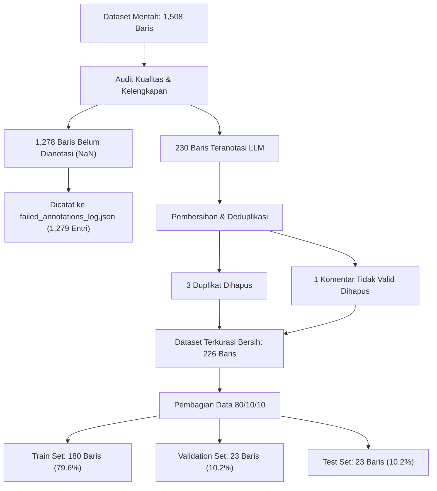

# 📊 Dataset Quality & Provenance Audit Report

**Artefak Data**: `output/final/iicd_cleaned_indobertweet.csv`  
**Sumber Input Mentah**: `output/checkpoints/checkpoint_Dataset-Research.csv`  
**Manifest Terkait**: `output/final/dataset_manifest.json`  
**Log Anotasi Gagal**: `output/final/failed_annotations_log.json`  
**Tanggal Kurasi**: 13 November 2026  
**Kebijakan Supervisi**: `pseudo_labeled_llm` (LLM-generated pseudo-labels, tanpa human ground truth)

---

## 1. Ikhtisar Dataset Mentah vs Dataset Terkurasi

Audit menyeluruh dilakukan terhadap file checkpoint aktif `checkpoint_Dataset-Research.csv` yang memuat 1.508 baris komentar teks media sosial berbahasa Indonesia.

### Ringkasan Angka Audit:
| Parameter Audit | Jumlah Baris | Persentase | Status / Keterangan |
| :--- | :---: | :---: | :--- |
| **Total Baris Dataset Mentah** | **1,508** | 100.00% | File `checkpoint_Dataset-Research.csv` |
| Baris Belum Teranotasi (`NaN` pada seluruh label) | 1,278 | 84.75% | Memerlukan batch annotation lanjutan |
| Baris Selesai Teranotasi LLM | 230 | 15.25% | Menggunakan `deepseek-v4.1-flash:netra` |
| Duplikasi Komentar Mentah (*Raw Duplicates*) | 3 | 0.20% | Dihapus saat kurasi (*deduplication*) |
| Komentar Kosong / Karakter `< 3` | 1 | 0.07% | Dihapus karena tidak memiliki muatan semantik |
| **Total Dataset Terkurasi Bersih** | **226** | 100.00% | Basis pelatihan dan pengujian saat ini |
| - *Train Set* | 180 | 79.65% | Digunakan untuk pelatihan bobot model |
| - *Validation Set* | 23 | 10.18% | Digunakan eksklusif untuk threshold tuning ($\tau^*$) |
| - *Test Set* | 23 | 10.18% | Evaluasi final E1–E6 dan Dual-XAI |

---

## 2. Verifikasi Pemisahan Data & Pencegahan Kebocoran (Zero Leakage)

Pemisahan data dilakukan menggunakan metode *Stratified Composite Pseudo-Label Split* (80/10/10) dengan seed acak `random_state = 42`.

Pemeriksaan kebocoran data (*data leakage check*) dilakukan secara ketat pada teks mentah maupun teks pasca-normalisasi leksikal:

| Jenis Pemeriksaan Kebocoran | Train vs Val | Train vs Test | Val vs Test | Status Integritas |
| :--- | :---: | :---: | :---: | :---: |
| Tumpang Tindih Komentar Mentah (*Exact Text*) | **0** | **0** | **0** | ✅ **ZERO LEAKAGE** |
| Tumpang Tindih Komentar Ternormalisasi (*Normalized Text*) | **0** | **0** | **0** | ✅ **ZERO LEAKAGE** |

Hal ini membuktikan bahwa tidak ada data uji yang pernah dilihat oleh model selama proses pelatihan atau penyesuaian hyperparameter.

---

## 3. Distribusi Kelas Taksonomi 6-Head (226 Baris Terkurasi)

Berikut adalah distribusi frekuensi, rasio ketimpangan, dan representasi kelas pada subset 226 baris terkurasi:

### A. Head 1: Cyberbullying Binary
* **YES (Cyberbullying)**: 156 sampel (69.03%)
* **NO (Non-Cyberbullying)**: 70 sampel (30.97%)
* *Imbalance Ratio*: 2.23 : 1
* *Karakter*: Mayoritas berlabel perundungan siber karena korpus awal dikumpulkan dari akun publik media sosial dengan tingkat polarisasi tinggi.

### B. Head 2: Bullying Type (9 Kelas Taksonomi)
| Kode | Nama Kategori | Jumlah Sampel | Persentase | Status Representasi |
| :---: | :--- | :---: | :---: | :--- |
| `INS` | Insult / Penghinaan Karakter | 98 | 43.36% | Mayoritas |
| `NONE` | Non-Cyberbullying | 70 | 30.97% | Baseline non-bullying |
| `BSH` | Body Shaming / Ejekan Fisik | 25 | 11.06% | Representatif |
| `SAR` | Sarcasm / Ejekan Sarkastik | 24 | 10.62% | Representatif |
| `SHM` | Shaming / Mempermalukan Publik | 6 | 2.65% | Terbatas |
| `DIS` | Discrimination / Ejekan SARA | 2 | 0.88% | **Minoritas Ekstrem ($\le 2$)** |
| `SEX` | Sexual Harassment / Pelecehan Seksual | 1 | 0.44% | **Minoritas Ekstrem ($\le 2$)** |
| `EDU` | Education Shaming | 0 | 0.00% | ⚠️ **Zero Representation** |
| `THR` | Threat / Ancaman Kekerasan | 0 | 0.00% | ⚠️ **Zero Representation** |

### C. Head 3: Dominant Emotion (6 Kelas Taksonomi)
| Kode | Nama Emosi | Jumlah Sampel | Persentase | Status Representasi |
| :---: | :--- | :---: | :---: | :--- |
| `MOCK` | Mockery / Mencemooh | 118 | 52.21% | Mayoritas dominan |
| `NEU` | Neutral / Netral | 68 | 30.09% | Baseline netral |
| `DIS` | Disgust / Muak | 30 | 13.27% | Representatif |
| `ANG` | Anger / Kemarahan | 7 | 3.10% | Terbatas |
| `HUM` | Humiliation / Terhina | 2 | 0.88% | **Minoritas Ekstrem ($\le 2$)** |
| `SAD` | Sadness / Kesedihan | 1 | 0.44% | **Minoritas Ekstrem ($\le 2$)** |

### D. Head 4: Cultural Context (8 Kelas Taksonomi)
| Kode | Konteks Budaya | Jumlah Sampel | Persentase | Status Representasi |
| :---: | :--- | :---: | :---: | :--- |
| `NONE` | Tanpa Konteks Budaya Khusus | 111 | 49.12% | Mayoritas |
| `APP` | Appearance Norm / Standar Fisik Budaya | 64 | 28.32% | Representatif (*beauty standard*) |
| `INT` | Intellectual Competence / Ejekan Kecerdasan | 28 | 12.39% | Representatif |
| `STA` | Social Status / Hierarki Sosioekonomi | 16 | 7.08% | Representatif |
| `GEN` | Gender Stereotype / Peran Gender | 3 | 1.33% | Terbatas |
| `REG` | Regional / Dialek Daerah | 3 | 1.33% | Terbatas |
| `FAM` | Family Kinship / Ejekan Keluarga | 1 | 0.44% | **Minoritas Ekstrem ($\le 2$)** |
| `EXC` | Exclusive Culture / Budaya Eksklusif | 0 | 0.00% | ⚠️ **Zero Representation** |

### E. Head 5: Implicitness Level (3 Kelas Taksonomi)
| Kode | Tingkat Keterbukaan | Jumlah Sampel | Persentase | Keterangan |
| :---: | :--- | :---: | :---: | :--- |
| `E1` | Implicit (Terselubung / Sarkasme Tunggal) | 122 | 53.98% | Mayoritas kasus perundungan halus |
| `E0` | Explicit (Terbuka / Vulgar / Non-Bullying) | 104 | 46.02% | Kasus lugas |
| `E2` | Complex Implicit (Multilayer / Eufemisme Kompleks) | 0 | 0.00% | ⚠️ **Zero Representation** |

### F. Head 6: Severity Level (4 Kelas Taksonomi)
| Kode | Tingkat Keparahan | Jumlah Sampel | Persentase | Keterangan |
| :---: | :--- | :---: | :---: | :--- |
| `LOW` | Rendah | 105 | 46.46% | Ejekan ringan / sindiran |
| `NONE` | Tidak Ada (Non-Bullying) | 70 | 30.97% | Selaras dengan non-cyberbullying |
| `MEDIUM` | Sedang | 50 | 22.12% | Serangan karakter / fisik personal |
| `HIGH` | Tinggi | 1 | 0.44% | **Minoritas Ekstrem ($\le 2$)** |

---

## 4. Log Kegagalan Anotasi (Failed Annotations Audit)

Seluruh baris yang tidak memenuhi syarat kurasi dicatat dalam `output/final/failed_annotations_log.json` sebanyak **1.279 entri**:
1. **1.278 Entri**: Berasal dari baris mentah yang belum menerima respons dari API LLM (`NaN` pada kolom target `cyberbullying`, `type`, dll.). Status dicatat sebagai `not_annotated_in_checkpoint`.
2. **1 Entri**: Berasal dari komentar dengan panjang `< 3` karakter (`"Je"`), yang tidak memuat konteks linguistik yang memadai untuk pembelajaran representasi teks. Status dicatat sebagai `rejected_short_comment`.

Dengan sistem logging ini, integritas data terjaga transparan tanpa ada sampel yang hilang secara diam-diam.

---

## 5. Kesimpulan Kualitas Dataset & Dampak Ilmiah

1. **Keunggulan Dataset Terkurasi (226 Baris)**:
   - Terbukti bersih dari duplikasi dan kebocoran lintas split.
   - Mengandung fitur representasi 33 dimensi Stream B non-leaky yang konsisten.
   - Format pseudo-label lengkap 6 dimensi taksonomi.
2. **Keterbatasan Metodologis**:
   - Keberadaan kelas dengan jumlah sampel nol (`E2`, `EDU`, `THR`, `EXC`) serta kelas minoritas ekstrem ($\le 2$ sampel) membatasi generalisasi evaluasi pada kategori-kategori spesifik tersebut.
   - Ukuran test set (23 sampel) memerlukan penambahan anotasi pada sisa 1.278 baris sebelum hasil dapat dianggap sebagai kesimpulan validasi final disertasi.

