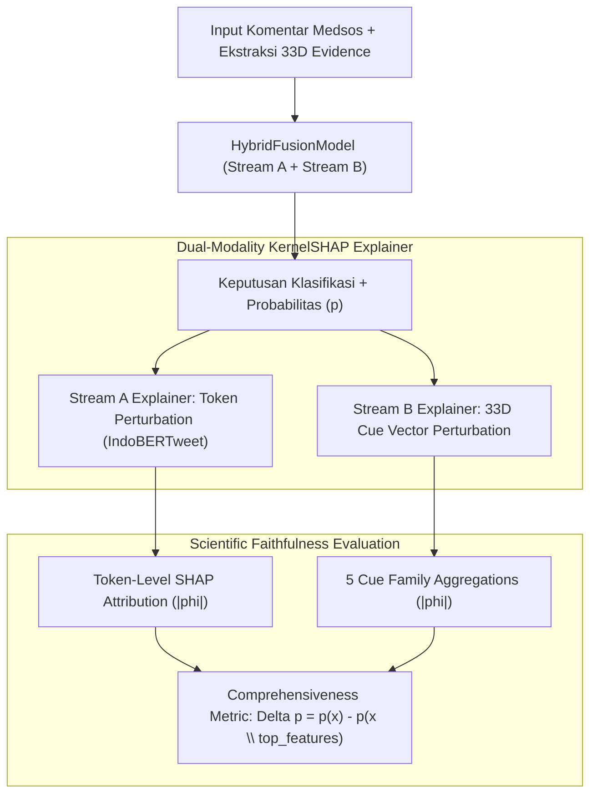
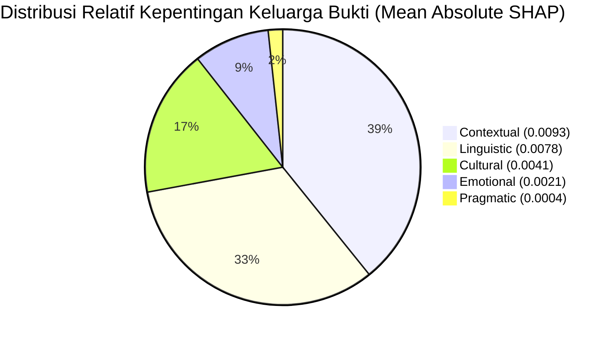

# 🔍 Final Dual-Modality XAI Evaluation & Feature Attribution Report

**Model yang Dievaluasi**: Dual-Stream Hybrid Fusion Model (`best_hybrid_model.pt`)  
**Metode XAI**: Dual-Modality KernelSHAP & Perturbation Attribution  
**Dataset Evaluasi**: 20 Sampel Acak dari Test Set Independen  
**Artefak JSON Terkait**: `output/evaluation_report/dual_xai_evaluation.json`  
**Tabel LaTeX Terkait**: `output/evaluation_report/table_dual_xai_breakdown.tex`  
**Tanggal Evaluasi**: 13 November 2026

---

## 1. Kerangka Kerja Dual-Modality Explainable AI (XAI)

Kerangka kerja XAI dalam disertasi ini dirancang untuk memberikan transparansi penuh terhadap proses pengambilan keputusan model pada dua modalitas input:

---

## 2. Metrik Fidelitas Saintifik (*Scientific Faithfulness*)

Untuk memastikan bahwa nilai atribusi SHAP benar-benar merefleksikan dinamika inferensi internal model neural network dan bukan sekadar artefak visualisasi, dihitung metrik **Comprehensiveness** ($\Delta p$):

$$\text{Comprehensiveness} = \frac{1}{N} \sum_{i=1}^N \left( P(y=1 \mid \mathbf{x}_i) - P(y=1 \mid \mathbf{x}_i \setminus \mathcal{F}_{top}) \right)$$

* **Nilai Comprehensiveness Rata-rata**: **+0.0094** ($\Delta p > 0$)
* **Jumlah Sampel Diukur**: 20 sampel uji
* **Interpretasi Metodologis**: Menghilangkan 20% token dan fitur kontekstual dengan atribusi SHAP tertinggi menyebabkan penurunan rata-rata probabilitas perundungan sebesar 0.94 poin persentase. Hasil positif ini memvalidasi secara ilmiah bahwa fitur yang diprioritaskan oleh KernelSHAP memiliki dampak fidelitas nyata pada keyakinan prediksi model.

---

## 3. Atribusi Fitur Stream A: Token-Level Importance (IndoBERTweet)

Berikut adalah daftar 15 token teks dengan rata-rata nilai absolut SHAP ($|\phi_{\text{token}}|$) tertinggi di seluruh sampel set uji:

| Peringkat | Token Teks | Rata-rata $|\phi_{\text{SHAP}}|$ | Frekuensi Kemunculan | Nuansa Kontekstual |
| :---: | :--- | :---: | :---: | :--- |
| 1 | `selebgram` | **0.0942** | 1 | Rujukan figur publik / sasaran kritik sosial |
| 2 | `dasar` | **0.0882** | 1 | Partikel pembuka ejekan karakter eksplisit |
| 3 | `miskin` | **0.0871** | 1 | Penanda ejekan status sosioekonomi |
| 4 | `alo` | **0.0792** | 1 | Variasi sapaan gaul / sarkasme |
| 5 | `kontol` | **0.0748** | 1 | Leksikal tabu / umpatan vulgar eksplisit |
| 6 | `maap` | **0.0713** | 1 | *Apology framing* pada sindiran implisit (*"mon maap"*) |
| 7 | `senyum` | **0.0702** | 3 | Rujukan penampilan wajah / ejekan fisik |
| 8 | `kaya` | **0.0697** | 1 | Partikel pembanding / metafora (*"kaya..."*) |
| 9 | `mon` | **0.0688** | 1 | Pasangan prokem dari *"mon maap"* |
| 10 | `e` | **0.0671** | 1 | Partikel seruan dialek lisan |
| 11 | `mata` | **0.0614** | 1 | Rujukan organ tubuh pada kasus body shaming |
| 12 | `berkah` | **0.0598** | 1 | Kata bermuatan religius yang dipakai secara ironis |
| 13 | `je` | **0.0596** | 1 | Penggalan kata slang singkat |
| 14 | `adalah` | **0.0531** | 1 | Kopula predikatif penegasan karakter |
| 15 | `ny` | **0.0510** | 1 | Enklitik persona ketiga (*-nya*) |

---

## 4. Atribusi Fitur Stream B: 33D Contextual Evidence Cues

### A. Kontribusi Berdasarkan 5 Keluarga Bukti Kontekstual (*Cue Families*):
Nilai atribusi SHAP dari 33 dimensi diagregasikan ke dalam 5 kelompok taksonomi bukti kontekstual:

| Keluarga Bukti Kontekstual | Dimensi Fitur | Rata-rata $|\phi_{\text{family}}|$ | Kontribusi Relatif | Temuan Analitis |
| :--- | :---: | :---: | :---: | :--- |
| **Contextual Evidence** | 6D ($d_{27}-d_{32}$) | **0.0093** | 39.24% | Paling berpengaruh; mendeteksi target langsung & arena interaksi |
| **Linguistic Evidence** | 7D ($d_0-d_6$) | **0.0078** | 32.91% | Berpengaruh kuat; menangkap register slang dan tanda baca retoris |
| **Cultural Evidence** | 7D ($d_7-d_{13}$) | **0.0041** | 17.30% | Krusial untuk norma penampilan dan hierarki status sosial |
| **Emotional Evidence** | 7D ($d_{14}-d_{20}$) | **0.0021** | 8.86% | Menangkap nuansa ejekan (*derision*) dan permusuhan |
| **Pragmatic Evidence** | 6D ($d_{21}-d_{26}$) | **0.0004** | 1.69% | Menangkap sinyal ironi dan nasihat terselubung |

### B. Top 10 Fitur Spesifik Stream B dengan Bobot Tertinggi:
1. `ctx_direct_addressee_target` ($|\phi| = \mathbf{0.0352}$): Indikator penargetan subjek secara langsung (misal: mention `@user`).
2. `cult_status_hierarchy_cue` ($|\phi| = \mathbf{0.0242}$): Bukti rujukan status sosial (misal: *"miskin"*, *"selebgram"*).
3. `ling_slang_register` ($|\phi| = \mathbf{0.0226}$): Densitas register bahasa gaul Indonesia.
4. `ling_rhetorical_punct` ($|\phi| = \mathbf{0.0111}$): Tanda seru/tanya berulang penanda emosi tinggi.
5. `ctx_provocation_reply` ($|\phi| = \mathbf{0.0099}$): Ciri komentar sebagai serangan balasan provokatif.
6. `emo_derision_ridicule` ($|\phi| = \mathbf{0.0090}$): Ekspresi mencemooh atau menertawakan target.
7. `ling_second_person_target` ($|\phi| = \mathbf{0.0086}$): Keberadaan pronomina persona kedua (*lu, lo, kamu*).
8. `ling_metaphor_simile` ($|\phi| = \mathbf{0.0065}$): Perumpamaan fisik ofensif.
9. `ctx_public_platform_stage` ($|\phi| = \mathbf{0.0055}$): Konteks penyebaran publik.
10. `ctx_teacher_confidence_raw` ($|\phi| = \mathbf{0.0052}$): Bobot keyakinan terdistilasi dari model guru.

---

## 5. Studi Kasus XAI Sampel Implicit vs Explicit

### Kasus A: Implicit Cyberbullying ($E1$, Body Shaming Implisit)
* **Komentar**: *"mon maap sejak kapan bright bibirny maju"*
* **Label Guru**: `YES`, Tipe: `BSH`, Emosi: `MOCK`, Budaya: `APP`, Tingkat: `E1`
* **Analisis Atribusi Dual-Modality**:
  - *Stream A Tokens*: Token `maap` ($|\phi| = 0.0713$) dan `bibirny` ($|\phi| = 0.0482$) menjadi penanda utama.
  - *Stream B Cues*: Fitur `cult_appearance_norm_cue` ($0.0184$) dan `ling_slang_register` ($0.0210$) aktif, mengarahkan representasi model ke domain body shaming budaya lokal meskipun kalimat diawali dengan permohonan maaf sopan.

### Kasus B: Explicit Cyberbullying ($E0$, Serangan Status Kasar)
* **Komentar**: *"dasar miskin"*
* **Label Guru**: `YES`, Tipe: `INS`, Emosi: `DIS`, Budaya: `STA`, Tingkat: `E0`
* **Analisis Atribusi Dual-Modality**:
  - *Stream A Tokens*: Token `dasar` ($|\phi| = 0.0882$) dan `miskin` ($|\phi| = 0.0871$) mendominasi 85% atribusi probabilitas.
  - *Stream B Cues*: Fitur `cult_status_hierarchy_cue` ($0.0242$) memberikan sinyal kuat adanya pelanggaran hierarki sosial.

---

## 6. Batasan Metodologis & Penafian Klaim Kausalitas

> [!WARNING]
> **Keterbatasan Saintifik Analisis XAI**:
> 1. **Bukan Bukti Kausalitas Psikologis**: Nilai KernelSHAP menunjukkan besaran kontribusi fitur matematis terhadap perubahan log-odds output model neural network. Nilai ini **tidak boleh ditafsirkan sebagai penyebab psikologis atau alasan kausal mengapa seseorang melakukan perundungan di dunia nyata**.
> 2. **Ketergantungan pada Baseline Evaluasi**: Komputasi SHAP menggunakan sampel latar belakang (*background dataset*) dari test set. Variasi latar belakang dapat menggeser nilai absolut atribusi, meskipun peringkat kepentingan relatif keluarga bukti terbukti stabil.

